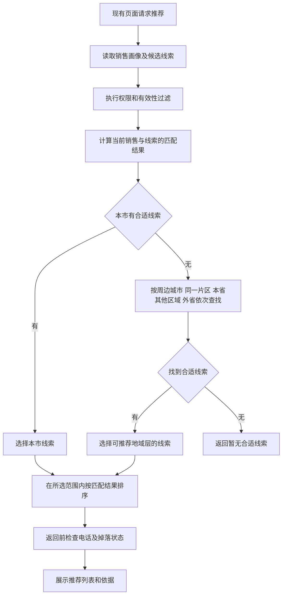
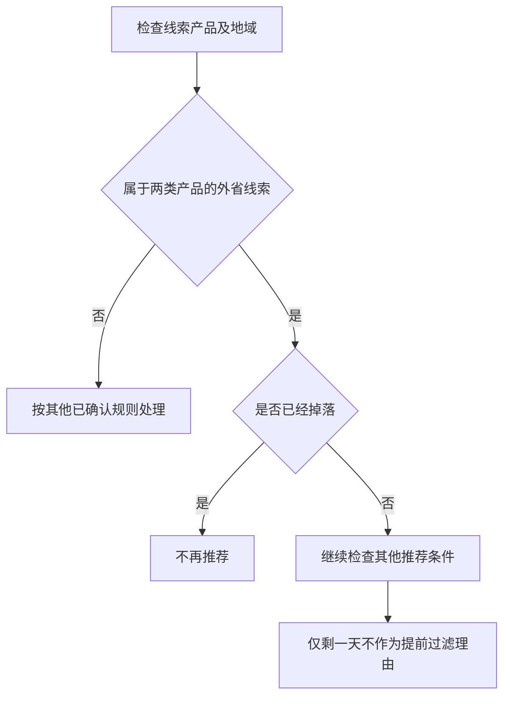

# 个性化商机推荐产品需求文档

## 00 文档说明

| 项目 | 内容 |
| --- | --- |
| 版本 | V0.1，2026-09-10 |
| 状态 | PRD 草稿，供产品、算法、研发和测试评审 |
| 需求依据 | [商机推荐模型业务说明](商机推荐模型业务说明.md)、本任务中用户对规则的补充确认 |
| 配套分析 | [需求分析草稿](个性化商机推荐_PRD草稿_20260910_assets/需求分析草稿.md) |
| 本版内容 | 按最新确认规则整理推荐流程，采用七个业务维度名称，补充数据要求与验收用例 |
| 未决事项 | 统一使用 TBD 编号，详见第 16 节；本稿未核验服务代码或线上运行状态 |

用户已确认模型可以预测销售对所有线索的认领概率和成交概率，七类特征已经参与计算。本稿将这些能力与地域、电话、掉落规则整理为可评审的产品需求。“模型能计算”不等于“所有线索都会展示给销售”；展示结果仍要满足业务规则及现有权限。

# 第一部分 业务需求

## 01 背景与目标

需求背景：销售熟悉的行业、产品和地区不同，同一条线索交给不同销售，认领与成交的结果也不同。

目标：结合销售历史认领、成交记录和双方画像，在遵守地域与有效性规则的前提下，为销售排列适合其跟进的线索。

业务价值：减少销售筛选线索的时间，提高推荐后的认领和成交效果。指标基线与目标值待确认。

## 02 用户场景与业务流程

### 02.1 使用场景

销售在现有 CRM 推荐页面查看线索，了解推荐依据，再自行决定查看详情、认领或跟进。入口位置与既有操作沿用现有页面，不新增跨省审批或自动分配。

### 02.2 推荐主流程

模型承担匹配与排序，地域和过滤条件由推荐服务执行。销售自行认领、跟进，系统不替销售确认需求或成交。

“合适”的计算判定待 Q01 确认；非本市层级的具体扩展触发条件待 Q02 确认。返回前状态检查是保证不展示已无效结果的实现要求，不新增业务状态。

## 03 需求定义

### 03.1 功能清单

| 编号 | 功能 | 输入 | 输出 | 需求依据 |
| --- | --- | --- | --- | --- |
| F01 | 线索有效性过滤 | 电话有效状态、线索状态、既有权限 | 可进入推荐的候选集合及过滤原因 | 无效电话直接过滤；适用掉落规则的线索掉落后不推荐 |
| F02 | 地域选择 | 销售地域、客户地域、合适判定 | 本次使用的地域范围及线索集合 | 本市优先，空集后逐步扩大 |
| F03 | 个性化匹配 | 销售历史记录、能力画像、七类维度与交叉组合 | 认领概率、成交概率、内部匹配得分、排序 | 已确认模型能力 |
| F04 | 外省掉落规则衔接 | 产品、认领时间、成交及掉落状态 | 当前是否可推荐 | 两类产品认领后 7 天未成交掉落 |
| F05 | 推荐结果表达 | 排序结果、客户信息、推荐依据 | 现有页面推荐列表 | 适合先了解，不承诺成交 |
| F06 | 后续反馈利用 | 查看、认领、跟进、释放、成交记录 | 后续评估和训练数据 | 后续行为用于调整推荐，接入和更新周期待确认 |

### 03.2 地域规则

| 规则 | 明确要求 |
| --- | --- |
| R01 跨区跟进 | 销售可以跨区、跨省跟进；不以“非本市”或“非本省”直接剔除所有线索 |
| R02 本市优先 | 只要本市存在合适线索，本次优先选择本市；不得仅因本市数量少就用远地区补量 |
| R03 本市扩展条件 | 本市合适线索数为 0 时，才进入后续地域范围；“合适”须在有效性过滤后判断 |
| R04 扩展顺序 | 本市 → 周边城市 → 同一片区 → 本省其他区域 → 外省区域 |
| R05 高分不越级 | 外省线索的内部匹配得分再高，也不能跳过本市优先规则 |
| R06 地域与排序 | 先确定本次可推荐范围，再在该范围内比较销售与线索的匹配结果 |
| R07 地域口径 | 销售所属城市、实际负责片区、客户注册地等字段不能互相替代；使用哪个字段判断归属及外省，见 Q04 |

业务示例：鲁西销售所在城市有合适线索时，先推荐本市。本市一条合适线索都没有时，再按顺序向周边和更远区域找。不得把“同属山东省”当作全部处于同一推荐层。

周边城市与同一片区的映射和重叠归层见 Q02。本稿不自行列城市名单或设公里数阈值。

### 03.3 电话过滤规则

| 规则 | 条件 | 处理 |
| --- | --- | --- |
| R08 | 已确认电话无效的线索 | 直接过滤，不用降低分数代替过滤 |
| R09 | 电话未验证 | 不等于电话无效；允许继续参与匹配，销售联系时先核实 |
| R10 | 没有电话、同一客户多个电话中部分无效 | 处理口径 TBD，不能套用“已确认电话无效”的结论 |

电话状态以业务系统的有效性结果为依据，不能由模型根据企业规模、摘要或推荐分推断。`unverified` 的具体校验流程含义待 Q07 确认。

### 03.4 外省线索掉落规则

| 规则 | 条件 | 处理 |
| --- | --- | --- |
| R11 适用范围 | 易达宝或网络货运产品，且按业务口径判为外省线索 | 适用本节 7 天规则；不扩展到其他产品或省内线索 |
| R12 起算点 | 销售认领线索 | 从认领后开始计算 7 天，不使用创建时间或进入线下时间代替 |
| R13 掉落 | 适用线索在规定的 7 天内未成交 | 按现有线下规则掉落；具体时间边界见 Q05 |
| R14 临期推荐 | 还未掉落，距离掉落仅剩 1 天 | 仍可参与推荐，不因只剩 1 天而提前过滤；其他条件仍须满足 |
| R15 掉落后 | 适用上述规则且已经掉落 | 不再推荐；旧推荐结果也不能继续作为有效结果返回 |

推荐服务读取现有线下状态，不自行新增掉落任务或重置计时。倒计时展示、临期加分或降分均未确认，不纳入本次功能。

已认领线索仍可推荐的具体对象与入口见 Q06。R14 不表示可以把已归属某销售的线索开放给其他销售重新认领。

### 03.5 匹配与 AI 任务

| 任务 | 输入 | 输出 | 业务要求 |
| --- | --- | --- | --- |
| 认领预测 | 当前销售、线索及认领前可得信息 | 该销售对该线索的认领概率 | 判断销售接手倾向，不作为成交结论 |
| 成交预测 | 销售与线索特征及历史成交记录 | 该销售对该线索的成交概率 | 与认领分别判断；成交观察期及条件定义见 Q08 |
| 匹配排序 | 单项、交叉特征及预测结果 | 内部匹配得分和顺序 | 计算公式、两个概率如何参与得分由算法说明，不在本稿编造加权公式 |
| 推荐依据表达 | 实际匹配依据和可用客户信息 | 推荐原因 | 不编造客户需求，不把“高优先级”写成“确定有需求” |

同一线索给不同销售，计算结果可不同。并非要求每条线索在任意两位销售下都得到不同分数。匹配得分仅供内部排序使用，不新增前端展示。

## 04 能力边界

| 本次负责 | 本次不负责 |
| --- | --- |
| 结合销售和线索信息预测、排序 | 保证认领或成交 |
| 根据已确认规则过滤和选择地域范围 | 根据模型高分越过地域优先顺序或权限 |
| 衔接现有认领、成交、掉落记录 | 自动认领、重新分配、修改客户归属或重设 7 天计时 |
| 保留现有推荐页面并明确推荐含义 | 新增模型配置后台、匹配分展示或临期倒计时 |

早期讨论的“不喜欢”反馈不在最新业务说明的功能范围中，本次不新增反馈弹窗。其后续是否单独实施另行确认。

# 第二部分 AI 与系统方案

## 06 系统职责与特征设计

### 06.1 模块职责

| 模块 | 职责 | 输入与输出 |
| --- | --- | --- |
| CRM 与画像数据 | 提供销售、客户、线索和历史行为 | 提供原始字段、业务状态及发生时间 |
| 特征计算与模型 | 单项和交叉计算、认领与成交预测 | 输入时点合规的特征，输出内部预测及匹配结果 |
| 推荐服务 | 权限过滤、地域选择、电话及掉落检查、排序结果交付 | 输入候选和匹配结果，输出推荐名单 |
| 现有推荐页面 | 展示列表、推荐原因和客户信息 | 不把内部匹配分作为新增页面字段 |

### 06.2 七类匹配维度

七类名称为本版业务命名，与此前技术方案分类一一对应，不因此改变模型的计算字段。

| 业务名称 | 业务含义与计算内容 | 对应原分类与来源线索 |
| --- | --- | --- |
| 企业基本情况 | 行业、是否物流公司、企业规模、注册及实缴资本、参保人数、成立年限、经营状态、注册城市、认证情况、同一客户线索数量、电话数量及风险 | 客户画像；`crm_customer`，关联字段映射待核实 |
| 销售覆盖与客户联系人 | 这类业务有多少销售覆盖；客户联系人数量、是否包含能决定购买的人 | 用户画像；`crm_user_biz_scope`、`crm_customer_contact` |
| 客户需求与跟进情况 | 紧急级别、重点跟进标记、跟进阶段、线索池、需求描述详细程度、摘要风险信息 | 线索画像；`crm_sale_clue`、摘要 |
| 客户位置与运输路线 | 注册省份、运输起点和终点、是否有运输路线 | 地图画像；客户地域、`start_addr`、`end_addr` |
| 线索信息新鲜度 | 首次录入时段、是否周末、获取到首次录入的时间间隔 | 时效性；`acq_time` 与首条 SAVE 记录 |
| 企业身份与线索来源 | 统一社会信用代码、来源、获取方式 | 权威性；`uscc`、`source_code`、`acq_method` |
| 企业经营风险 | 注销、吊销，以及摘要中的被执行人、处罚、诉讼、失信等风险信息 | 安全风控；经营状态和摘要 |

该表是已确认的特征分类口径，不表示每条线索的全部字段均完整，也不表示销售覆盖数等同于某个销售的个人能力。个人能力画像仍须来自销售历史与已维护信息。

### 06.3 交叉特征与得分

交叉特征把多个条件放在一起计算，例如“公海查看次数与认证状态”“公海查看次数与渠道”“公海查看次数与业务范围”。各项计算结果共同形成销售与线索的内部匹配得分。

技术方案中的条形图展示模型权重统计，不能把图上数值直接相加作为某条线索的匹配分，也不能作为成交概率或准确率。具体交叉清单、模型版本及得分公式由算法提供，见 Q09。

## 07 数据来源与时间口径

### 07.1 数据要求

| 数据 | 来源 | 使用要求 |
| --- | --- | --- |
| 销售历史认领、成交、跟进、释放 | CRM 业务记录 | 关联销售与线索，并保留事件时间；事实表和关联字段待核实 |
| 销售能力与地域 | 销售画像、组织及业务范围记录 | 不把所属省份直接当作全部可服务地区 |
| 七类画像 | 第 06.2 节来源 | 缺失、未知与明确无效必须区分 |
| 认领时间及掉落状态 | 现有线下业务记录 | 用于 R12—R15；到期计算边界见 Q05 |
| 电话状态 | 现有校验或业务反馈记录 | 明确无效直接过滤；未验证不得自动视为无效 |
| 模型输出 | 当前已确认的个性化模型 | 内部关联销售、线索、模型版本及计算时间；具体接口字段名 TBD |

现有接口已提供销售标识、线索标识、排名、推荐原因、客户画像等信息。内部匹配分和两个概率如何提供给推荐服务、是否需扩展接口，见 Q09；不得把现有线索评分充当内部匹配分。

### 07.2 防止使用事后信息

R16：预测销售是否认领，只能使用该次认领前已存在、且在实际推荐时可取得的信息。测试与训练必须按历史时间取值，不能用今天的字段覆盖历史快照。

例如，线索上午 10 点被认领，信息上午 11 点才生成，该信息不能用于预测 10 点的认领。AI 摘要若在认领后生成，只能作离线对比，实际推荐需使用认领前已有摘要。

紧急级别、重点跟进、阶段、线索池、查看次数和历史掉落记录也要检查时间。如果只有认领后取值，就不能直接放入该次认领预测；保留字段清单不等于放宽时间限制。相关字段的有效快照和缺失处理见 Q08。

### 07.3 持续学习

后续查看、认领、跟进、释放和成交结果用于评估并调整推荐。已记录行为不等于模型已即时更新；接入现状、训练周期与发布方式均为 TBD。不把“未认领”自动解释为“明确不喜欢”，未曝光或观察期未结束的线索不能直接当作已失败结果。

## 08 推荐原因要求

推荐原因依据实际数据说明客户为何适合当前销售。可说明行业或产品匹配；只有地域判断成立时，才能写“区域相近”。“其他行业”不能进一步编造具体行业优势。

需求信息不足时，文案应说明需核实需求；电话未验证不能写成“联系方式有效”。不新增大模型生成链路，沿用现有模板或服务，具体实现由研发确认。

建议文案：“客户所在行业与您历史成交方向相近，当前需求信息较少，建议先联系确认需求。”仅在对应事实成立时使用。

## 09 页面与交互

| 页面内容 | 展示要求 | 状态及用户动作 |
| --- | --- | --- |
| 推荐列表 | 按服务返回的推荐排名展示；不自行按客户评分重排 | 销售沿用现有入口查看详情、认领或跟进 |
| 推荐原因 | 简短说明已验证的匹配依据，不承诺成交 | 查看客户信息后确认需求 |
| 需求信息不足 | 不编造需求或购买意向 | 销售联系核实 |
| 电话未验证 | 与已确认无效区分；提示位置沿用现有页面，具体状态映射 Q07 | 销售先核实号码 |
| 无有效结果 | 显示“暂无合适线索”，不以无效线索凑数 | 通过既有刷新方式重新查询 |

不新增匹配分、认领概率、成交概率的前端展示。本次不制作新页面原型，既有页面定位与刷新方式见 Q03。

# 第三部分 人机协作与产出物管理

## 11 销售操作与业务状态

| 操作 | 执行者 | 系统处理要求 |
| --- | --- | --- |
| 获取推荐 | 推荐服务 | 读取并返回线索，不改变归属 |
| 认领或跟进 | 销售通过现有 CRM 操作 | 沿用既有权限及提交机制，记录实际业务结果 |
| 成交或释放 | 现有业务流程 | 以业务事实为准，不由模型分数触发 |
| 掉落 | 现有线下规则 | 推荐服务读取状态并剔除适用的已掉落线索 |

推荐名单只是辅助销售选择。线索被展示不等于已被认领，模型预测成交不等于 CRM 已成交。

## 12 推荐结果留存

建议为评估和问题排查关联推荐批次、销售、线索、地域层级、排名、模型版本、计算时间及过滤原因。字段名、保存位置、期限与现有日志复用方式由研发确认，不新增业务下载或分享功能。

# 第四部分 异常处理与效果度量

## 13 异常与边界处理

| 场景 | 处理要求 | 待确认依赖 |
| --- | --- | --- |
| 本市只有 1 条合适线索 | 优先返回本市，不因数量少用外省补量 | 展示数量上限 Q03 |
| 本市原有线索全部因电话无效被过滤 | 按本市合适线索为 0 继续向外查找 | 合适判定 Q01 |
| 各地域范围均无合适线索 | 返回空结果，不突破过滤条件 | 无 |
| 线索仍有 1 天到期但未掉落 | 不因临期单独过滤；归属和其他规则仍适用 | 推荐对象 Q06 |
| 计算后、结果返回前线索已掉落 | 从本次有效结果剔除；重新检查可用结果 | 缓存失效与刷新时效 Q03 |
| 电话未验证 | 允许参与匹配，不能宣称已可接通 | 枚举含义与提示 Q07 |
| 电话缺失或部分号码无效 | 不推断为全部有效或全部无效，待明确统一规则 | Q07 |
| 客户或销售地域缺失 | 不把未知地区直接归为本市；具体兜底 TBD | Q04 |
| 新销售缺少历史记录 | 不编造历史成交依据；采用何种冷启动排序 TBD | Q08 |
| 模型或数据服务失败 | 不把失败当作“没有线索”而扩大地域；失败提示与重试沿用现有机制 | Q03 |

## 14 行为记录与效果度量

### 14.1 记录要求

以下为建议评估口径，不代表现有埋点已完成。事件应关联同一销售与线索，避免将别人的认领误归因给本次推荐。

| 事件 | 记录时机 | 用途 |
| --- | --- | --- |
| 推荐曝光 | 卡片实际展示给销售时，不以接口返回代替曝光 | 形成效果评估分母 |
| 查看详情 | 销售打开详情 | 分析查看行为 |
| 认领 | CRM 确认认领成功 | 对比认领预测与结果 |
| 跟进、释放、成交 | CRM 业务记录确认后 | 分析后续结果与训练反馈 |
| 过滤或扩区 | 推荐服务执行对应规则时 | 排查无效线索、地域越级与空结果 |

### 14.2 效果指标建议

| 指标 | 建议计算口径 | 尚需确认 |
| --- | --- | --- |
| 推荐查看率 | 观察期内查看过详情的曝光销售与线索组合数 / 曝光组合数 | 观察期与去重范围 |
| 推荐认领率 | 观察期内被对应销售认领的曝光组合数 / 曝光组合数 | 观察期、已认领跟进提醒与新认领推荐需分开统计 |
| 推荐成交率 | 观察期内归属对应销售并成交的曝光组合数 / 曝光组合数 | 成交定义、归因窗口及重复曝光规则 |
| 规则执行情况 | 检查已确认无效电话、适用已掉落线索是否仍返回，以及是否违反本市优先 | 以第 15 节用例作为功能验收依据 |

分母为 0 时标记无样本，不计算为 0%。按地域层、产品和模型版本分组分析。指标目标及历史基线 TBD，不承诺未经验证的提升比例。

## 15 验收用例

以下是待执行用例，不是测试通过报告。使用固定测试销售、候选集、业务状态和模型版本；“合适/不合适”测试输入按 Q01 确认后的判定准备。

| 用例 | 输入或前置条件 | 预期结果 | 对应规则 |
| --- | --- | --- | --- |
| T01 | 本市有合适线索，外省线索匹配更高 | 本市优先，外省高分不能越级 | R02、R05 |
| T02 | 本市只有 1 条合适线索，请求数大于 1 | 不因数量少向外省补量 | R02 |
| T03 | 本市原始线索非空，但过滤后无合适线索 | 向周边城市开始查找 | R03、R08 |
| T04 | 本市无合适线索，周边有合适线索 | 周边优先于后续地域层；具体补量口径待 Q02 | R04 |
| T05 | 所有层级均无合适线索 | 返回空结果 | R03—R04 |
| T06 | 电话已确认无效，模型匹配高 | 仍直接过滤 | R08 |
| T07 | 电话未验证，其他条件满足 | 不按电话无效过滤，不声称号码可接通 | R09 |
| T08 | 易达宝或网络货运外省线索，认领后剩 1 天，未掉落且其他条件满足 | 不因临期提前剔除 | R11、R14 |
| T09 | 同类外省线索已因 7 天未成交掉落 | 不再推荐；请求刷新不返回旧有效结果 | R13、R15 |
| T10 | 其他产品外省线索，或两类产品省内线索 | 不套用本节 7 天掉落规则 | R11 |
| T11 | 创建时间早于认领时间多天 | 以认领时间起算，不用创建时间替代 | R12 |
| T12 | 认领为 10 点、信息在 11 点生成 | 不使用 11 点信息预测 10 点认领 | R16 |
| T13 | 同一线索，对两个不同画像销售计算 | 分别输出对应结果；允许不同，也允许数值相同 | F03 |
| T14 | 内部匹配结果更新 | 页面沿用返回排名，不新增匹配分或两个概率展示 | 第 09 节 |
| T15 | 需求信息为空但其他条件满足 | 可推荐，不生成“已确认需求”等无依据结论 | 第 08 节 |
| T16 | 到期边界、重新认领、多电话混合状态、无历史销售 | 等对应 Q 项确认后补充唯一预期；当前不能判定通过 | Q05、Q07、Q08 |

## 16 待确认事项

| 编号 | 决策内容 | 影响 | 建议确认方 |
| --- | --- | --- | --- |
| Q01 | 线索“合适”的阈值或判断方法 | 本市是否为空与扩区触发 | 产品、算法 |
| Q02 | 周边及片区名单、重叠归层；非本市层级是否也仅在 0 条时扩展 | 地域筛选与补量 | 业务、产品 |
| Q03 | 推荐上限、并列排序、刷新及缓存时效、现有页面定位和服务失败处理 | 排序、掉落状态更新、页面验收 | 产品、研发 |
| Q04 | 销售与客户城市/省份使用哪个字段，外省判定基准，地域缺失兜底 | 跨省规则是否命中 | 业务、研发 |
| Q05 | 7 天的精确边界、重新认领或分配后的计时、成交后推荐处理 | 掉落与结果过滤 | 业务、研发 |
| Q06 | 已认领且剩 1 天线索推荐给谁、在哪个入口展示，现有归属规则 | 防止误开放认领和错误套用已占用过滤 | 业务、产品 |
| Q07 | 多电话部分无效、没有电话的策略；未验证枚举含义及提示位置 | 电话过滤与文案 | 业务、研发 |
| Q08 | 历史快照、缺失值、认领与成交标签/观察期、成交概率是否以认领为条件、冷启动和更新周期 | 模型训练与效果统计 | 算法、数据 |
| Q09 | 字段映射、认证类型、查看次数统计对象、交叉清单、内部得分公式及接口 | 匹配计算与服务对接 | 算法、研发 |

以上未决项不影响已确认能力的描述，但影响开发口径和验收。评审后应将确认结果写入对应规则，不能用实现人员的默认选择替代业务决定。
