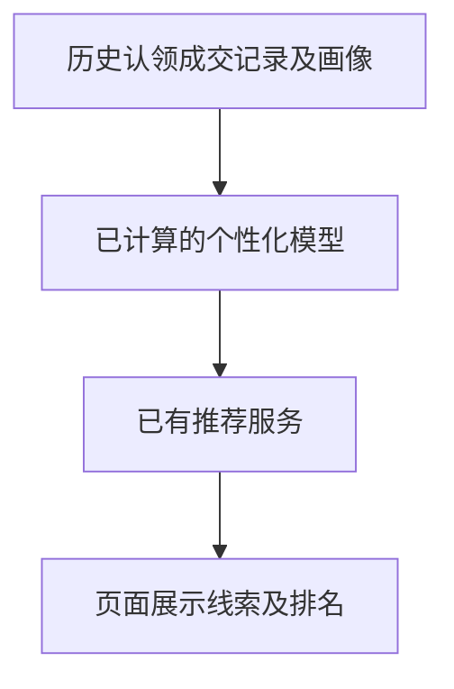
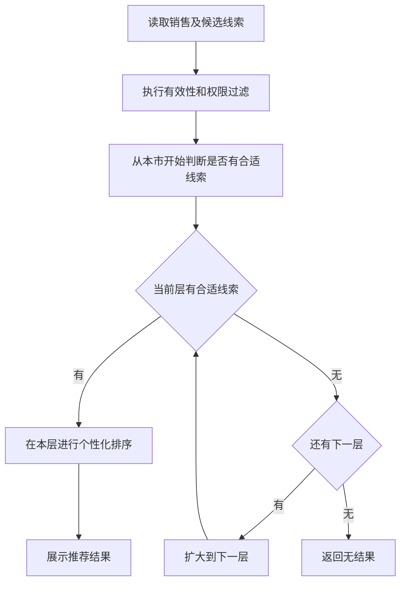

# 个性化商机推荐需求分析草稿

日期：2026-09-10。依据：[最新版业务说明](../商机推荐模型业务说明.md)及本任务中用户确认的规则。本文用于支撑 PRD，不表示已完成上线核验。

## 一、需求背景分析

销售熟悉的行业、产品和客户不同，需要根据历史认领、成交记录，以及销售和线索画像推荐适合各自跟进的线索。模型预测能力和七类特征已计算，属于用户确认的现状；地域规则与状态过滤需要在推荐服务中得到一致执行。旧 PRD 中“本市不足即扩区”“进入线下起算”等表述不再作为本次依据。

## 二、需求目标确认

| 编号 | 已确认事项 | 来源 |
| --- | --- | --- |
| C01 | 模型能预测销售对所有线索的认领概率、成交概率 | 用户明确确认；业务说明开头 |
| C02 | 本市优先，本市一条合适的线索都没有才向外扩展；外省高匹配不能跳过本市 | 用户明确确认；业务说明第二节 |
| C03 | 本市、周边城市、同一片区、本省其他区域、外省区域依次扩展；支持跨区跨省跟进 | 业务说明第二节 |
| C04 | 易达宝及网络货运的外省线索，认领后开始计算 7 天，未成交按现有规则掉落 | 用户明确确认；业务说明第二节 |
| C05 | 上述线索剩 1 天仍可推荐，掉落后不再推荐 | 用户对掉落规则的补充确认 |
| C06 | 已确认电话无效直接过滤；未验证不等于无效 | 用户明确确认；业务说明第四节 |
| C07 | 七类特征已计算；仅使用认领前已有的信息预测认领 | 用户明确确认；业务说明第三节 |
| C08 | 采用企业基本情况、销售覆盖与客户联系人、客户需求与跟进情况、客户位置与运输路线、线索信息新鲜度、企业身份与线索来源、企业经营风险七个名称 | 用户要求根据新名称编写 PRD |
| C09 | 匹配分不在页面展示；页面已有分数是线索分数 | 用户对页面分数的确认 |
| C10 | 后续查看、认领、跟进、释放和成交结果用于调整推荐；具体接入与更新周期未确认 | 业务说明第三节及前序确认 |

范围为现有 CRM 推荐能力的需求整理，不另建后台、分配机制、跨省审批或匹配分展示。早期讨论的不喜欢反馈不作为本次新增功能，若单独实施需另行确认范围。

## 三、业务流程分析

### 3.1 当前流程

仅记录已提供的现状，不将模板中的销售秘书 Demo 当作 CRM 实现证据。

### 3.2 目标流程

本市非空时不向远层补量是已确认规则。其他层级是否同样“仅为空才扩层”列为待确认，流程中的通用判断为建议实现口径。

## 四、功能拆解清单

以下 P0/P1 是本稿建议的实施顺序，排期待确认，不代表已承诺上线日期。

| 编号 | 模块 | 功能 | 内容 | 建议优先级 |
| --- | --- | --- | --- | --- |
| F01 | 推荐服务 | 有效性过滤 | 无效电话、适用规则下已掉落线索不进入结果 | P0 |
| F02 | 推荐服务 | 地域选择 | 本市优先，空集后按地域顺序扩大 | P0 |
| F03 | 算法 | 个性化匹配 | 七类维度、交叉组合、认领及成交预测、内部匹配得分 | P0 |
| F04 | 推荐服务 | 掉落规则衔接 | 认领起算、剩 1 天可推荐、掉落后剔除 | P0 |
| F05 | 现有推荐页面 | 结果表达 | 排名与推荐依据、需求待核实；不新增匹配分展示 | P0 |
| F06 | 算法与数据 | 后续行为利用 | 记录并使用认领、跟进、成交等结果；更新周期 TBD | P1 |

## 五、待确认事项

| 编号 | 待确认事项 | 建议确认方 | 状态 |
| --- | --- | --- | --- |
| Q01 | “合适”的模型阈值或判定方法 | 产品、算法 | TBD |
| Q02 | 周边城市与片区映射、重叠归层，非本市层级扩展触发条件 | 业务、产品 | TBD |
| Q03 | 推荐数量、同分处理、刷新周期及缓存时效 | 产品、研发 | TBD |
| Q04 | 销售和客户地域的事实字段、外省判定所比较的省份 | 业务、研发 | TBD |
| Q05 | 7 天自然日或小时边界、重新认领或分配是否重算、成交后推荐处理 | 业务、研发 | TBD |
| Q06 | 已认领线索继续推荐给原销售的入口，与其他销售可认领候选的归属规则 | 业务、产品 | TBD |
| Q07 | 多个电话部分无效、没有电话的处理；未验证枚举的实际定义 | 业务、研发 | TBD |
| Q08 | 训练时间快照、标签观察期、成交概率口径、行为数据接入和更新周期 | 算法、数据 | TBD |
| Q09 | 七类字段映射、查看次数口径、认证类型、现有接口是否提供所需内部结果 | 算法、研发 | TBD |

验收应先按已确认规则编写；依赖 Q 项的用例在确认前不能标为通过。
