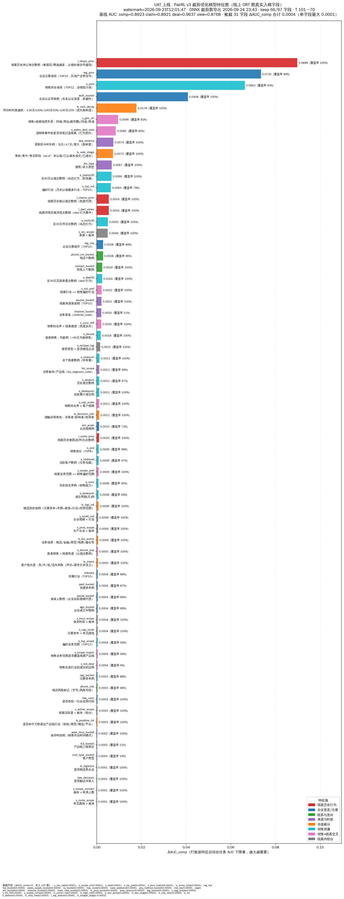

## 一句话总结

根据销售历史上认领、成交的线索记录，以及销售的能力画像、线索的画像，训练个性化模型，模型能预测销售对所有线索的认领概率、成交概率。类似抖音上面千人千面的推荐模型。

认领概率表示这个销售愿不愿意接手这条线索，成交概率表示后面做成的机会大不大。

有的线索销售愿意接，但后面不一定容易做成，所以认领和成交需要分别判断，不能只看销售愿不愿意接。

## 一.  系统判断逻辑

1. 模型会先学习销售过去做过的客户：以前经常做哪些行业，卖哪些产品，哪些地区的客户做得比较多，什么样的客户最后比较容易成交。

2. 模型会分析现在的线索：客户在哪儿，做什么行业，公司规模怎么样，有没有联系电话，电话有没有验证过、是否有异常记录，有没有联系人，客户有没有留下比较明确的需求，线索是从哪里来的，信息是不是已经过时。

把这些情况进行匹配，系统会判断：

> 这条线索交给这个销售，他是不是比较容易接手？后面做成的机会大不大？

模型进行个性化推荐。简单说，不同销售看到的推荐顺序可以不一样，因为每个人擅长的方向和过去的经验不一样。

## 二. 地区匹配逻辑

了解到目前销售可以跨区、跨省跟进客户，所以客户不在本市，并不代表一定不能推荐。

系统优先推荐本市合适的线索。如果本市一条合适的线索都没有，就再往周边城市找，并按地域顺序逐步扩大范围。

推荐范围按这个顺序逐步扩大：本市 → 周边城市 → 同一片区 → 本省其他区域 → 外省区域。地区主要决定先从哪里找线索，销售可以跨区、跨省跟进。

> 比如销售在鲁西地区，系统优先推送销售所在城市合适的线索；如果本市一条合适的线索都没有，再往鲁西周边城市找，之后才会考虑山东其他地区。

当推荐范围扩大到外省时，模型也会结合销售过去的跨省跟进经验，以及客户和历史成交客户的相似程度，判断这条线索是否适合当前销售。

只要本市还有合适的线索，仍然优先推荐本市。外省线索即使匹配分更高，也不能因此跳过本市优先的顺序。

对于易达宝及网络货运产品：外省线索从销售认领后开始计算 7 天，7 天内没有成交，就按现有线下规则掉落。这条规则针对这两个产品的外省线索，不自动扩展到其他产品。

## 三. 重点匹配的维度

模型目前已经从下面七个方面计算销售和线索的匹配情况：

1. **客户**：客户做什么行业，是不是物流公司，公司规模多大，注册和实缴资本是多少，有多少员工参保，成立了多少年，经营是否正常，注册在哪个城市，有没有认证，以及同一客户有多少条线索记录、多少联系电话，电话有没有风险。
2. **用户**：这类业务有多少销售覆盖，客户有多少联系人，联系人中有没有能决定购买的人。
3. **线索**：需求是否紧急，是否被标记为重点跟进，目前跟进到哪一步、在哪个线索池，需求写得是否详细，摘要里有没有风险信息。
4. **地区**：客户注册在哪个省份，有没有填写运输起点和终点，是否有运输路线。
5. **时效性**：线索首次录入是什么时段，是工作日还是周末，从获取信息到首次录入系统隔了多久。
6. **权威性**：有没有统一社会信用代码，线索从哪里来、通过什么方式获取。
7. **安全风控**：企业有没有注销、吊销，摘要里有没有被执行人、处罚、诉讼、失信等风险信息。

模型只能根据销售认领线索之前就已经存在的信息，来预测销售是否会认领。

> 例如：
>
> 线索在上午 10 点被销售认领；
>
> 信息在上午 11 点才生成。

那么，这份 11 点生成的信息不能用于预测销售在 10 点时是否会认领，因为销售认领时还看不到这份信息。

模型会把几个条件放在一起进行计算。比如，一条线索被查看了很多次，同时客户已经认证，与“查看很多次但没有认证”的情况，就需要分别判断。各项计算结果汇总后，得到这条线索与当前销售的匹配得分。后续也会根据销售查看、认领、跟进、释放和成交的结果，调整推荐。

### 本次补充：新模型具体看哪些信息

前面七个方面是原有的说明。下面按照这次新图的分类，把模型具体参考的信息补充进来，其中也包含原来已经使用的信息，不是每一项都是这次新增的。

这张图对应 PairRL v3 裁剪优化模型，图中标注为 UAT（验收测试环境）版本，导出时间为 2026 年 9 月 24 日。图中说明，原有 97 个字段保留了 66 个。这里的字段，可以理解为模型判断时用到的一项项信息；这不代表下面有 66 类，也不能仅凭这张图判断正式环境已经全部上线。

1. **线索以前被跟进过的情况**：这条线索以前掉回公海多少次，被认领过多少次，被查看过多少次，有过多少次跟进拜访。模型会参考这些记录，但不是掉落越多就越好，也不是被查看得多就一定容易成交。

2. **客户的基本情况和资质**：客户注册在哪个省、市，做什么行业，公司规模多大，注册和实缴资本是多少，有多少员工参保，成立了多少年，认证情况怎么样，有没有统一社会信用代码。

3. **客户能不能联系上、目前是什么意向**：有多少电话和联系人，电话有没有风险，接触到的是决策人、影响购买的人，还是实际使用的人；客户目前处于什么阶段，意向是高、中、低，还是有流失风险。客户意向是模型参考的判断，不等于客户已经承诺购买。

4. **线索从哪里来、信息还新不新**：线索来自哪个渠道，获取到现在过了多久，最近的拜访离现在有多远。比如，同样有过拜访，最近刚拜访和很久以前拜访过，模型会分别计算。

5. **销售过去做成客户的情况**：销售以前成交过多少客户，过去接手的客户有多少最后做成了，通常需要多久成交。模型不只看销售愿不愿意认领，也会参考过去实际做成的情况。

6. **销售熟悉什么、最近在忙什么**：销售在哪个省份，是什么岗位，是新销售还是老销售，过去经常接哪些行业和业务的客户；最近 30 天认领、查看、拜访了多少次，手上有多少条线索、正在跟进多少客户。这些会一起作为推荐的参考，不是手上线索多就一定少推。

7. **这个销售和这条线索合不合适**：销售和客户的地域关系，客户的行业和业务是不是销售熟悉的方向，销售之前有没有看过这条线索，以及销售过去的成交能力与这条线索的跟进难度是否匹配。地区信息参与计算，但不改变前面“本市优先、逐步扩大”的推荐顺序。

8. **客户的几个条件放在一起看**：比如企业规模和行业一起看、有没有运输路线和业务类型一起看、注册资本和运输路线一起看。不能只因为公司规模大，或者有运输路线，就直接判断这条线索适合推荐。

简单说，这次补充后，业务可以更具体地看到：模型不仅看客户是什么样，也看线索以前被怎么跟进过、销售过去做成过什么客户、最近在跟进什么，再把这些情况放在一起，判断这条线索适不适合当前销售。

### 这张图怎么看

从这次结果看，排在前面的信息是：线索历史掉回公海次数、企业注册省份、销售所在省份、企业认证情况，以及距离拜访过去了多久。销售和线索的地域关系、这个销售之前是否看过这条线索，也排在比较靠前的位置。

这张图不是之前的“左边单个条件、右边组合条件”图，也不是把各项分数加起来。它的做法是：把某项信息打乱，再看模型的整体判断效果下降多少。条形越长，说明这次测试中，模型越依赖这项信息。

> 重要性高，不代表这个数值越大就越值得推荐。图中的数值不是认领概率、成交概率或销售看到的线索分数；旁边的“覆盖率”也不是成交率。图上方的 AUC 是模型评估指标，不能直接当成推荐准确率，更不能用来承诺成交效果。

上面提到的历史成交、查看、拜访、意向和跟进阶段，都只能使用做出预测之前已经有的记录，不能把后面才发生的结果提前放进去。

## 四. 推荐结果说明

> 推荐不代表客户一定会买，也不代表系统已经确认客户有明确需求。

客户所在区域合适、行业比较匹配、企业信息比较完整，都会作为推荐的参考。同一条线索给不同销售，推荐顺序可能不同。

已经确认电话无效的线索，系统直接过滤掉，不再推荐。电话还没有验证，不等于电话无效；这类线索仍可以推荐，销售联系时需要先核实。

如果需求信息比较少，销售联系时还是要先确认真实需求。“高优先级”表示值得先了解，不代表客户需求已经核实。
