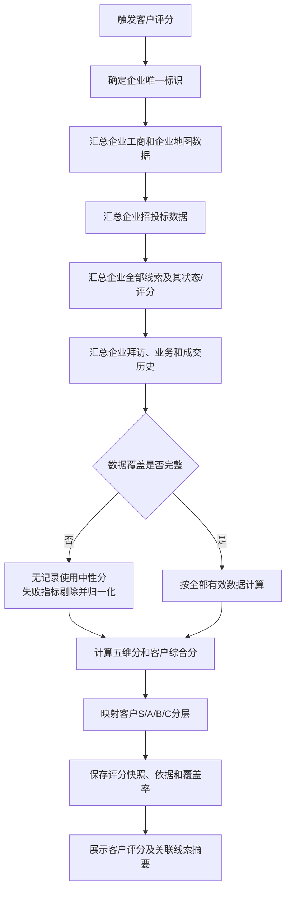

# 客户评分升级 PRD（草稿）

> 状态：PRD 草稿。评分规则已依据第1期内容确定；数据接口、评分基线和人工校准权限仍需上线前核对。

## 00 使用说明

| 版本 | 日期 | 变更内容 | 变更人 |
| --- | --- | --- | --- |
| V0.2 | 2026-09-02 | 统一缺失数据、中性分、数据源失败、企业发展命名及关闭线索规则 | 刘君 |
| V0.1 | 2026-09-01 | 从客户与线索评分合并草稿中拆分客户评分需求 | 刘君 |

# 第一部分：业务需求

# 01 项目背景与目标

一句话目标：CRM介入企业地图拓客，基于企业唯一标识进行客户评分，快速发现周边高潜企业。

# 02 用户场景与交互流程

| 用户角色 | 场景 | 结果 |
| --- | --- | --- |
| 销售 | 查看企业档案/客户画像 | 查看客户分、等级、企业依据和关联线索概览 |
| 销售负责人 | 比较企业整体潜力 | 按客户S/A/B/C分层制定经营策略 |



流程描述：客户评分聚合企业级事实与关联线索结果，但不将线索评分简单相加；系统按客户评分规则重新计算，AI仅抽取企业增长、需求、互动和风险信号。

# 03 需求定义

## 03.1 关键业务规则

| 规则ID | 规则内容 |
| --- | --- |
| C-001 | 评分对象唯一为企业；同一企业下多条线索不得生成多个客户评分对象。 |
| C-002 | 企业只有工商和招投标数据时，允许计算客户分；数据源查询成功但确实无记录时按指标中性分计算，不自动记负分。 |
| C-003 | 企业存在工商、招投标及多条线索评分时，客户分使用企业级规则汇总计算；线索分仅作为可追溯输入和关联展示，不直接相加替代客户分。 |
| C-004 | 不同产品类型线索的产品行为、拜访和成交数据不得跨产品线直接合并；客户级汇总需保留产品类型维度。 |
| C-005 | 关闭和成交线索均保留历史状态及评分快照；成交线索参与需求潜力的历史成交指标，关闭线索不参与客户分，仅在关联线索摘要中展示。 |
| C-006 | “查询成功但无记录”与“数据源失败”分别记录：前者使用确定的中性分，后者对应指标不参与计算，并对该维度剩余有效指标权重归一化。 |
| C-007 | 风险信息采用100分起评，按近180天风险企业的风险指数中位数计算风险信息分，不使用第1期固定扣分。 |
| C-008 | 风险数据查询成功且无记录时风险信息分为100；风险核心数据源查询失败时，失败的风险指标不参与计算并明确提示覆盖缺口，不得按无风险处理。风险指标全部查询失败时，风险信息维度使用50分中性分并标记“风险数据待补充”。 |
| C-009 | 每次评分必须保存企业ID、数据快照时间、数据源、纳入的线索范围、命中规则、贡献分/扣分、原文依据、覆盖率、模型版本和评分版本。 |
| C-010 | 客户分最终截断到0-100；客户分≥80为S级，60-79为A级，40-59为B级，<40为C级。 |
| C-011 | 数据源查询成功但无历史成交或无拜访记录属于“信息不足”，不得直接记0或作为C级理由；历史成交使用10分中性分，拜访意向使用12分中性分。其他指标无记录时，若指标表未另行规定，统一按该指标权重分的50%作为中性分。 |
| C-012 | 企业命中公司物流产品或商贸产品、风险信息分≥70、无明确拒绝且仅因缺少成交/拜访导致综合分<40时，启用信息稀疏保护：最终分调整为40，分层为“B级·信息待补充”。 |
| C-013 | 产品匹配必须输出产品标签及命中依据。物流、货运、仓储、物流服务、供应链物流命中公司物流产品；批零/制造相关，或经营范围包含金属、矿、消费品、大宗商品、期货，命中公司商贸产品。 |
| C-014 | 注册资本不得采用“越高分越高”的统一规则。物流产品以注册资本<500万元为最高适配档；商贸产品以100万元-1亿元为最高适配档；纳税能力和资金实力估算同时参考实缴比例。 |

## 03.2 数据覆盖场景

| 场景 | 参与计算 | 展示要求 |
| --- | --- | --- |
| 仅工商信息 | 五个客户维度均参与；工商指标正常计分，查询成功但无记录的指标使用中性分，数据源失败的指标剔除后在维度内归一化 | 标记招投标、拜访、线索等数据为“无记录”或“数据源失败” |
| 工商+招投标 | 五个客户维度均参与；工商和招投标指标正常计分，其余指标按数据状态规则处理 | 展示招投标时间范围、数量、依据及其他数据覆盖状态 |
| 工商+招投标+多条线索评分 | 企业级维度 + 关联线索摘要/确认可纳入的历史结果 | 展示线索数量、产品类型、状态分布和纳入规则 |
| 全量数据 | 按客户评分配置计算 | 展示各数据源覆盖率和更新时间 |

## 03.3 评分维度

| 维度 | 业务含义 | 主要数据 | 权重 |
| --- | --- | --- | --- |
| 纳税能力 | 判断企业持续经营及税收贡献能力 | 企业所得税、增值税/营业税、纳税增长、纳税信用等级；无税额时使用注册资本适配、实缴比例、纳税等级、参保人数 | 20% |
| 风险信息 | 判断企业经营、司法、舆情及产品流失风险 | 被执行人、失信被执行人、经营异常、行政处罚、股权出质、司法案件、限制高消费、法人变更、注销/吊销、重大诉讼/仲裁、高管变动/负面新闻、物流沉寂/流失 | 20% |
| 需求潜力 | 判断企业购买我方产品的可能性 | 历史成交、工商行业、经营范围、招投标、拜访记录 | 30% |
| 企业发展 | 反映成长能力与业务扩张情况；分数越高表示成长能力越强 | 营业收入增长率、净利润增长率、工商扩张、战略布局舆情、扩张类招投标 | 15% |
| 资金实力 | 判断企业使用自有资金或融资推动项目的能力 | 经营现金流、现金比率、流动比率；无财务数据时使用注册资本适配、实缴比例、融资金额、对外投资 | 15% |

## 03.3.1 打分理由生成规则

系统必须将评分依据转化为销售可执行的客户判断。评分理由不展示“获得X分”“扣X分”或计算档位，统一采用“客户当前优势 + 已取得的进展 + 下一步努力方向”结构。具体分值只在评分明细中展示。

| 评分场景 | 理由生成格式 | 面向销售的展示示例 |
| --- | --- | --- |
| 历史成交 | `合作基础 + 客户优势 + 下一步方向` | “该客户在物流产品线上已有成交和合作基础，说明客户对我方产品及交付具备一定认可。建议重点推进复购、增购和关联产品拓展。” |
| 多条线索 | `已取得进展 + 当前机会组合 + 下一步方向` | “该客户的物流线索已成交，商贸线索正在推进，已形成跨产品合作基础。建议复用既有合作关系，确认商贸场景的决策人、预算和落地时间。” |
| 无成交数据 | `当前状态 + 可用优势 + 下一步方向` | “该客户暂未形成历史成交，但企业基础和行业方向具备开发价值。建议先验证核心需求和采购计划，推动建立首个合作场景。” |
| 纳税能力 | `计算路径 + 经营贡献 + 下一步方向` | “当前根据注册资本、纳税信用等级和参保人数进行估算，企业具备稳定经营基础。建议补充近12个月纳税额，以便进一步确认实际经营贡献能力。” |
| 资金实力 | `计算路径 + 资金基础 + 下一步方向` | “企业注册资本和融资记录显示具备一定项目投入基础。建议在商务推进中进一步确认可用预算、付款方式和资金审批周期。” |
| 企业发展 | `增长信号 + 当前短板 + 下一步方向` | “企业近期出现注册资本增加和数字化升级项目，业务处于扩张阶段。建议优先核实扩张项目的实施范围和物流配套需求。” |
| 产品匹配 | `工商行业/经营范围 + 命中产品 + 下一步方向` | “企业属于批发零售行业，经营范围包含金属和大宗商品，已命中公司商贸产品。建议进一步确认实际交易品类、采购规模和供应链服务需求。” |
| 工商与招投标 | `企业基础优势 + 外部需求信号 + 下一步方向` | “企业经营稳定，具备一定规模，近期出现数字化系统采购需求。建议尽快核实招标阶段、采购范围和我方切入方式。” |
| 需求潜力-新需求 | `现有合作 + 新需求 + 下一步方向` | “客户已使用基础货运服务，近期又提出仓配一体化需求，存在进一步拓展仓储系统的机会。建议准备对应方案并确认预算及实施范围。” |
| 需求潜力-拜访 | `互动进展 + 客户态度 + 下一步方向` | “客户近期保持持续沟通，并愿意进一步了解收费和实施方案。建议趁当前沟通窗口推进方案演示，明确下一次决策节点。” |
| 风险信息 | `风险事实 + 业务影响 + 下一步方向` | “客户存在经营异常信息，合作和回款稳定性需要核实。建议确认异常原因、最新经营状态及付款保障后再推进商务条件。” |
| 线索关闭 | `关闭事实 + 可复用信息 + 下一步方向` | “客户曾有线索因暂不需要而关闭，说明相关产品暂未进入采购窗口。建议保留已确认需求信息，并在出现扩张、招标或新负责人时重新触达。” |
| 无拜访数据 | `信息空白 + 判断限制 + 下一步方向` | “目前缺少有效拜访信息，尚不能判断客户的真实意向和决策进度。建议完成首次访谈，重点确认业务痛点、预算、决策链和项目时间。” |
| 数据缺失 | `缺失内容 + 判断限制 + 下一步方向` | “当前缺少招投标明细，无法判断近期采购动作。建议补充公开采购信息，或通过销售拜访确认客户是否存在相关项目计划。” |

评分结果至少展示一条“客户当前优势”和一条“下一步努力方向”。理由只能引用实际关联到该企业的数据，不得凭空生成“之前成单过”“客户有采购意向”等事实；没有成交、拜访或招投标证据时，必须明确说明信息不足并给出补充信息的行动建议。分值、权重和扣分只在“评分明细”中展示，不进入面向销售的理由文案。

## 03.4 客户分计算公式

```text
客户综合分 = 纳税能力分×20% + 风险信息分×20% + 需求潜力分×30%
             + 企业发展分×15% + 资金实力分×15%
```

五个维度均参与客户综合分计算，分别输出0-100分后按固定维度权重合成。企业注销、吊销、清算或命中失信被执行人时触发一票否决，客户综合分直接为0。

指标数据状态统一按以下规则处理：

1. 数据源查询成功且有记录：按指标档位计算。
2. 数据源查询成功但确实无记录：使用指标表规定的中性分；未单独规定时，中性分固定为该指标权重分的50%。业务规则明确“无记录即负向事实”的指标，按指标表中的0分档执行。
3. 数据源未接入、查询失败或解析失败：该指标不参与本次维度计算，不得记0或使用中性分；系统按该维度剩余有效指标权重归一化。
4. 某维度全部指标均因数据源失败而无法计算：该维度使用50分中性分，继续参与客户综合分，并标记“该维度数据待补充”。

```text
维度分 = Σ(有效指标实际得分) ÷ Σ(有效指标权重分) × 100
```

其中“有效指标”包含查询成功后按档位得分或使用中性分的指标，不包含数据源失败的指标。五个维度之间不重新分配权重。

### 03.4.1 纳税能力（0-100分）

#### A. 有税务金额数据

| 指标 | 权重分 | 计算方法 |
| --- | ---: | --- |
| 企业所得税 | 30 | 取近12个月所得税总额，与同行业、同规模企业中位数M比较：≥2M得30；1M-2M得24；0.5M-1M得15；0-0.5M得8；为0得0 |
| 增值税/营业税 | 25 | 取近12个月税额，与同行业、同规模企业中位数M比较：≥2M得25；1M-2M得20；0.5M-1M得13；0-0.5M得6；为0得0 |
| 纳税增长 | 20 | `(本期近12个月总纳税额-上期近12个月总纳税额)÷上期总纳税额`：≥20%得20；5%-19.99%得15；0%-4.99%得10；-20%至-0.01%得5；<-20%得0 |
| 纳税信用等级 | 25 | A级25；B级20；M级15；C级8；D级0；无等级0 |

`纳税能力分=企业所得税分+增值税/营业税分+纳税增长分+纳税信用等级分`。

#### B. 无税务金额数据时的替代计算

注册资本不按金额单调加分，先按命中产品计算“注册资本适配率”：

| 命中产品 | 注册资本区间 | 适配率 |
| --- | --- | ---: |
| 公司物流产品 | <500万元 / 500-999万元 / ≥1000万元 / 字段为空 | 100% / 60% / 20% / 0% |
| 公司商贸产品 | 100万元-1亿元 / <100万元 / >1亿元 / 字段为空 | 100% / 40% / 60% / 0% |
| 同时命中物流、商贸产品 | 分别计算 | 取较高适配率，不叠加 |
| 未命中公司产品 | 任意非空注册资本 / 字段为空 | 50% / 0% |

注册资本适配指标分=`注册资本适配率×该指标权重分`。

| 指标 | 权重分 | 评分条件 |
| --- | ---: | --- |
| 注册资本适配 | 30 | 按上述命中产品的注册资本适配率计算；物流产品注册资本<500万元得30分 |
| 实缴比例 | 20 | `实缴资本÷注册资本`：≥50%得20；20%-49.99%得12；0%-19.99%得5；实缴或注册资本为空得0 |
| 纳税信用等级 | 30 | A级30；B级24；M级18；C级9；D级0；无等级0 |
| 参保人数 | 20 | ≥100人得20；20-99人得15；1-19人得8；0人或字段为空得0 |

只要企业所得税或增值税/营业税存在有效金额，即使用A路径，不得与B路径重复计分。展示时标记“税务实算”或“工商估算”。

### 03.4.2 风险信息（0-100分）

风险信息分越高表示企业越安全。数据查询成功且以下风险均未命中时为100分。风险指数用于同批客户的中位数计算，不等同于固定扣分。

| 数据条件 | 风险标签 | 统计口径 | 单位风险指数 | 单类上限/处理 |
| --- | --- | --- | ---: | --- |
| 有被执行人记录 | 被执行人 | 当前未终结记录；每条计一次 | 6 | 18 |
| 有失信被执行人记录 | 失信被执行人 | 当前有效失信记录 | — | 一票否决：风险信息分及综合分均为0，客户分层为C级 |
| 列入经营异常名录 | 经营异常 | 当前仍在名录内；按企业状态计一次 | 4 | 4 |
| 有行政处罚记录 | 行政处罚 | 近24个月记录；每条计一次 | 2 | 6 |
| 有股权出质记录 | 股权出质 | 当前有效的股权出质；每条计一次 | 1 | 3 |
| 有司法案件记录 | 司法案件 | 近24个月内企业为被告、被申请人或被执行主体；每条计一次 | 2 | 6 |
| 有限制高消费记录 | 限制高消费 | 当前有效记录；每条计一次 | 8 | 16 |
| 法人变更 | 法人变更 | 近12个月发生法人变更；按企业计一次 | 2 | 2 |
| 工商状态为注销或吊销 | 已注销/已吊销 | 当前工商经营状态 | — | 一票否决：风险信息分及综合分均为0，客户分层为C级 |
| 舆情命中重大诉讼或仲裁 | 诉讼风险 | 近24个月重大诉讼/仲裁；每个独立事件计一次 | 6 | 12 |
| 舆情命中高管变动或负面新闻 | 高管变动 | 近12个月事件；每个独立事件计一次 | 2 | 4 |
| 物流产品线连续90天不发单 | 沉寂用户 | 以最后一笔有效订单日期计算；按企业物流产品线计一次 | 3 | 3 |
| 物流产品线沉寂后再连续90天不发单，即连续180天不发单 | 流失用户 | 以最后一笔有效订单日期计算；按企业物流产品线计一次 | 6 | 6；与沉寂用户互斥，只取流失用户 |

单类风险指数=`MIN(记录数×单位风险指数, 单类上限)`；企业风险指数为各单类风险指数之和。已经撤销、已移出、已终结或超过统计时间窗口的记录不参与当前风险指数，但保留历史依据。

```text
企业风险指数 I = Σ(各类风险条数×对应风险指数)
风险企业中位数 M = 近180天所有 I>0 企业的风险指数中位数
风险扣减值 D = MIN(100, 四舍五入(30×I÷M))
风险信息分 = MAX(0, 100-D)
```

风险核心数据源部分失败时，失败风险类型同时从当前企业风险指数I和中位数样本M中排除，M只能使用风险类型覆盖范围相同的企业计算，避免将“未查询到”误判为“无风险”。当I=0时风险信息分为100。不存在I>0的有效样本时，记为“风险样本为空”：当前企业I=0时风险信息分为100；当前企业I>0时沿用上一评分周期同覆盖范围的有效中位数，若不存在历史有效中位数，则风险信息维度使用50分中性分并进入人工核验。风险明细必须展示风险标签、原始数据条件、有效记录数、发生时间、当前状态、单类风险指数、数据覆盖范围和销售核验建议。

### 03.4.3 需求潜力（0-100分）

| 指标 | 权重分 | 评分条件 |
| --- | ---: | --- |
| 历史成交 | 20 | 命中产品线成交≥2次得20；命中产品线成交1次得18；其他产品线有成交得15；数据源查询成功且确认无历史成交得10；成交数据源失败时该指标不参与计算并标记“数据源失败” |
| 工商行业产品匹配 | 15 | 交通运输、货运、仓储、物流服务、供应链物流：得15并命中“公司物流产品”；批发零售、商贸流通、制造业：得15并命中“公司商贸产品”；其他行业得3；行业为空得0 |
| 经营范围产品匹配 | 10 | 包含运输、货运、仓储、配送、物流、供应链关键词：得10并命中“公司物流产品”；包含金属、矿、消费品、大宗商品、期货关键词：得10并命中“公司商贸产品”；均未命中或字段为空得0 |
| 注册资本产品适配 | 5 | 公司物流产品：<500万元得5，500-999万元得3，≥1000万元得1；公司商贸产品：100万元-1亿元得5，<100万元得2，>1亿元得3；同时命中取较高分；字段为空得0 |
| 招投标需求 | 25 | 近180天有物流/TMS/WMS/仓储/供应链项目：得25并强化物流产品匹配；有金属、矿产、消费品、大宗商品、期货、交易平台相关项目：得25并强化商贸产品匹配；有ERP、一般数字化升级项目得15；弱相关项目得5；无相关项目得0 |
| 拜访意向 | 25 | 明确采购、询价、要求方案或合同得25；有兴趣但需内部讨论得20；仅初步接触得15；数据源查询成功且近90天无拜访记录得12；明确暂无需求得5；明确拒绝或已选竞品得0；拜访数据源失败时该指标不参与计算并标记“数据源失败” |

历史成交按企业ID和产品线统计，订单按订单ID去重；招投标按项目编号去重；拜访意向使用近90天最近一次有效拜访，必须引用原文依据。无成交、无拜访获得的是中性保护分，只用于防止信息不足造成低分，不得在销售理由中描述为客户优势。

#### 产品匹配与计分规则

1. 工商行业、经营范围、注册资本适配分别计分，单项只取一个最高档，需求潜力中的产品匹配合计最高30分。
2. 同一企业同时命中物流产品和商贸产品时，两个产品标签均保留；不得因命中两个产品而突破30分上限。
3. 产品标签必须记录来源字段、命中关键词和更新时间。例如：`商贸产品｜来源：经营范围｜关键词：金属、大宗商品`。
4. 历史成交、招投标和拜访需求优先按照已命中的产品标签判断相关性；无法映射产品时只作为一般业务信号，不得判定为明确产品需求。

#### 信息稀疏保护

```text
若同时满足：
1. 企业命中“公司物流产品”或“公司商贸产品”；
2. 风险信息分≥70，且未触发一票否决；
3. 拜访记录中不存在明确拒绝、已选竞品或强烈不满；
4. 历史成交为“查询成功但无记录”或“数据源失败”，或拜访数据查询成功但近90天无拜访，或拜访数据源失败；
5. 按五维公式计算的综合分<40；
则客户最终分=40，分层=B级·信息待补充。
```

保护分不适用于未命中公司产品、存在明确负向意向或风险信息分<70的企业。后续补充成交、拜访、税务或财务数据后立即按完整公式重算，不再保留40分下限。

### 03.4.4 企业发展（0-100分）

分数越高代表企业成长能力越强。页面描述企业不足时统一使用“企业发展短板”，不得将本维度展示为“企业发展缺陷分”。

#### A. 有财务数据

| 指标 | 权重分 | 评分条件 |
| --- | ---: | --- |
| 营业收入增长率 | 35 | ≥30%得35；10%-29.99%得28；0%-9.99%得18；-10%至-0.01%得8；<-10%得0 |
| 净利润增长率 | 25 | ≥30%得25；10%-29.99%得20；0%-9.99%得13；-10%至-0.01%得5；<-10%得0 |
| 工商扩张 | 20 | 近12个月新增分公司/注册资本增加/新增对外投资：命中2项及以上得20；命中1项得10；无得0 |
| 战略布局舆情 | 15 | 明确扩产、融资、出海、并购、新业务布局得15；仅一般合作或规划得8；无正向扩张信息得0 |
| 扩张类招投标 | 5 | 近180天有生产扩建、仓储升级、物流网络或数字化升级项目得5；无得0 |

#### B. 无营业收入或净利润数据

| 指标 | 权重分 | 评分条件 |
| --- | ---: | --- |
| 工商扩张 | 40 | 近12个月新增分公司、注册资本增加、对外投资：命中3项得40；2项得30；1项得15；无得0 |
| 战略布局舆情 | 30 | 明确扩产、融资、出海、并购、新业务布局得30；一般合作或规划得15；无得0 |
| 扩张类招投标 | 30 | 近180天相关项目≥3条得30；2条得22；1条得12；无得0 |

营业收入和净利润任一字段缺失时使用B路径，A、B路径不得混算。

### 03.4.5 资金实力（0-100分）

#### A. 有财务数据

| 指标 | 权重分 | 评分条件 |
| --- | ---: | --- |
| 经营活动现金流量净额 | 35 | >0且同比增长≥20%得35；>0且同比增长0%-19.99%得28；>0但同比下降得18；≤0得0 |
| 现金比率 | 25 | ≥0.5得25；0.3-0.49得20；0.2-0.29得15；0.1-0.19得8；<0.1得0 |
| 流动比率 | 15 | ≥2得15；1.5-1.99得12；1-1.49得8；<1得0 |
| 累计融资金额 | 15 | ≥1亿元得15；3000万-9999万元得12；1000万-2999万元得8；1-999万元得4；无融资得0 |
| 注册资本适配 | 5 | 按纳税能力B路径中的注册资本适配率计算，指标分=`适配率×5` |
| 实缴比例 | 5 | ≥50%得5；20%-49.99%得3；0%-19.99%得1；字段为空得0 |

#### B. 无现金流量、现金比率或流动比率数据

| 指标 | 权重分 | 评分条件 |
| --- | ---: | --- |
| 注册资本适配 | 30 | 按纳税能力B路径中的注册资本适配率计算；物流产品注册资本<500万元得30分 |
| 实缴比例 | 20 | ≥50%得20；20%-49.99%得12；0%-19.99%得5；字段为空得0 |
| 累计融资金额 | 30 | ≥1亿元得30；3000万-9999万元得24；1000万-2999万元得18；1-999万元得10；无融资得0 |
| 对外投资 | 20 | 有效对外投资企业≥5家得20；2-4家得12；1家得6；无得0 |

现金流量、现金比率、流动比率三项任一缺失时使用B路径，展示时标记“财务实算”或“工商融资估算”。

### 03.4.6 客户分层

| 分层 | 分数范围 | 业务含义 |
| --- | ---: | --- |
| S级 | ≥80分 | 核心价值客户：纳税、资金和发展能力较强，并有明确需求或合作依据 |
| A级 | 60-79分 | 重点经营客户：企业基础较好，已出现部分需求、扩张或合作信号 |
| B级 | 40-59分 | 培育客户：具备一定经营基础，但需求和增长证据不足 |
| C级 | <40分 | 观察客户：经营、资金、需求或发展能力较弱，或触发重大风险 |

## 03.5 客户与线索分的关系

| 项目 | 客户分 | 线索分 |
| --- | --- | --- |
| 对象 | 企业 | 企业+产品类型+线索ID |
| 目的 | 判断企业整体潜力和经营价值 | 判断单条产品线索的推进潜力 |
| 数据范围 | 企业级全量有效数据 | 对应产品类型和线索数据 |
| 等级/分层 | 客户S/A/B/C，≥80/60-79/40-59/<40 | 线索高/较高/中/低潜力，≥80/60-79/40-59/<40 |
| 关系 | 可引用关联线索状态/结果，但不简单累加线索分 | 不反向覆盖客户分 |

# 04 能力边界

| 允许范围 | 禁止范围 | 处理 |
| --- | --- | --- |
| 聚合企业数据、解释客户分和关联线索 | 不得把线索分相加作为客户分，不得跨企业关联 | 返回对象或数据关联异常 |
| 抽取增长、需求、互动和风险依据 | 不得补造企业事件、成交事实或风险 | 展示原文、置信度并进入人工核验 |

# 第二部分：AI 与系统方案

# 06 Agent / Skill / Tool 设计

| 类型 | 名称 | 职责 |
| --- | --- | --- |
| Agent | 客户评分编排 Agent | 确定企业、汇总数据、调度计算和组织解释 |
| Skill | 企业增长分析 | 从工商变化和招投标数据提取增长/转型信号 |
| Skill | 企业需求分析 | 从已购产品、拜访和招投标提取未满足需求 |
| Skill | 企业风险分析 | 提取风险类型、数量、状态和原文依据 |
| Skill | 企业财务与税务分析 | 识别实算路径或替代估算路径并完成字段校验 |
| Tool | 企业数据查询 | 查询税务、财务、工商、企业地图、舆情、招投标、拜访、线索、成交和融资数据 |
| Tool | 客户评分计算 | 执行五维指标、替代路径、中位数风险公式和等级映射 |
| Tool | 评分快照 | 保存企业数据范围、依据和历史版本 |

# 07 数据来源

| 数据 | 用途 | 当前口径 |
| --- | --- | --- |
| 税务数据 | 纳税能力实算 | 近12个月企业所得税、增值税/营业税、上期税额及纳税信用等级 |
| 财务数据 | 企业发展、资金实力实算 | 营业收入、净利润、经营现金流量净额、现金比率、流动比率 |
| 工商/企业地图 | 企业基础信息、风险、人员、经营 | 字段范围按企业地图接入文档执行 |
| 招投标 | 企业增长和业务需求 | 使用招投标表的企业、标题、公告类型和发布时间字段 |
| 公司产品匹配配置 | 需求潜力和推荐产品 | 维护物流产品、商贸产品对应的行业、经营范围和招投标关键词 |
| 舆情/企业动态 | 战略布局与扩张信号 | 只使用可追溯的扩产、融资、出海、并购、新业务布局信息 |
| 物流产品订单 | 风险信息中的沉寂/流失识别 | 使用最后一笔已接单且未取消订单日期；连续90天无订单为沉寂，连续180天无订单为流失 |
| 融资与对外投资 | 资金实力估算 | 使用累计融资金额、融资时间、对外投资企业数量 |
| 拜访数据 | 企业互动和需求 | CSV为样例，非全量 |
| 关联线索及评分 | 产品类型、线索状态和结果摘要 | 按企业ID关联全部线索，按产品类型保留明细 |
| 成交/订单/合作 | 需求潜力 | 使用 CRM 线索状态及对应产品线订单/成交数据 |

# 08 AI 能力要求

AI输出必须包含：信号类型、信号内容、数据源、事件时间、原文依据、置信度及是否参与评分。AI不得修改评分公式、权重、阈值或中位数结果。

# 09 交互设计

| 组件 | 内容 |
| --- | --- |
| 企业价值评分卡 | 客户综合分、S/A/B/C分层、更新时间、数据覆盖率和计算路径标识 |
| 五维雷达图 | 纳税能力、风险信息、需求潜力、企业发展、资金实力五项0-100分 |
| 产品匹配标签 | 展示“公司物流产品”“公司商贸产品”及命中行业、经营范围或招投标依据；允许同时展示两个标签 |
| 指标解析卡 | 每个维度展示等级、当前优势、事实依据、数据来源和下一步努力方向；不展示加减分文案 |
| 关联线索摘要 | 线索数量、产品类型、进行中/关闭/成交状态、线索分分布；不替代客户分 |
| 评分依据面板 | 展示每个指标的字段值、命中条件、指标分、维度分、权重、公式、中位数和规则版本 |
| 数据覆盖提示 | 明确显示税务实算/工商估算、财务实算/工商融资估算及数据缺失项 |

# 第三部分：人机协作与产出物管理

# 11 用户确认与写操作

| 场景 | 规则 |
| --- | --- |
| 主动刷新 | 只查询和计算，不修改原始数据 |
| 依据纠正 | 进入待审核/重算状态，不直接写回原始标签 |
| 人工调分 | 不覆盖系统分；仅销售负责人可另存人工分、原因、人员和有效期 |

# 12 产出物

| 产出物 | 内容 | 保存位置 |
| --- | --- | --- |
| 客户评分快照 | 企业ID、分数、等级、维度明细、关联线索范围、依据、覆盖率、版本和时间 | CRM评分记录 |

# 第四部分：异常处理与效果度量

# 13 异常处理

| 场景 | 系统策略 | 提示 |
| --- | --- | --- |
| 仅工商信息 | 五个维度均参与；无记录使用中性分，失败指标剔除并在维度内归一化 | “当前评分主要基于工商数据，其他数据覆盖状态见评分明细” |
| 工商+招投标 | 五个维度均参与；工商和招投标正常计分，其他指标按数据状态规则处理 | “当前评分已包含工商和招投标数据，其他数据覆盖状态见评分明细” |
| 多条线索评分 | 作为关联摘要和按确认规则纳入的企业依据；不得简单相加 | 展示线索纳入范围和状态 |
| 成交线索 | 参与需求潜力的历史成交指标 | “该成交记录已纳入历史合作判断” |
| 关闭线索 | 不参与客户分，仅保留在线索历史和关联摘要中 | “该关闭线索仅用于查看历史，不参与客户评分” |
| 查询成功但无历史成交或无拜访 | 使用需求潜力中性分，不生成低价值或低意向结论 | “当前尚无合作/拜访记录，已使用中性分计算” |
| 成交或拜访数据源失败 | 失败指标不参与计算，在需求潜力维度内对剩余有效指标归一化 | “当前合作/拜访数据获取失败，该指标未参与本次评分” |
| 信息稀疏保护命中 | 按40分、B级处理，并记录保护原因 | “该企业基础行业匹配且无明显风险，建议优先补充需求和拜访信息” |
| 风险样本为空 | 当前企业风险指数为0时风险信息分100；风险指数大于0时优先沿用上一周期有效中位数，无历史基准则使用50分中性分并进入人工核验 | “当前样本无法形成有效风险中位数，已按历史基准或中性分处理” |
| 企业无法关联 | 停止评分 | “无法确定企业主体” |

# 14 埋点与指标

| 指标 | 口径 | 目标 |
| --- | --- | --- |
| 评分依据完整率 | 有来源、时间、规则/信号和依据的维度数/总维度数 | 100% |
| 缺失数据不扣分符合率 | 仅因数据缺失的客户未产生扣分的比例 | 100% |
| 信息稀疏保护正确率 | 满足C-012的企业均未被判为C级，且不满足条件的企业未被错误保护 | 100% |
| 客户/线索隔离正确率 | 客户分未被错误替换为线索分的客户比例 | 100% |
| 多线索归属正确率 | 企业下线索均正确关联且产品类型不串线的比例 | 100% |
| 风险中位数执行率 | 满足风险样本条件时正确使用风险指数中位数的评分比例 | 100% |
| 评分成功率 | 成功生成评分/触发评分 | ≥99% |

## 已确定实施口径

1. 企业评分采用纳税能力20%、风险信息20%、需求潜力30%、企业发展15%、资金实力15%的五维加权结构。
2. 无税务金额时，纳税能力使用注册资本适配、实缴比例、纳税信用等级和参保人数估算；无财务数据时，企业发展和资金实力分别使用工商扩张、舆情、招投标、注册资本适配、实缴比例、融资和对外投资估算。
3. 客户分为S、A、B、C四级；线索仍使用高、较高、中、低潜力四级，客户分和线索分独立计算，互不替代。
4. 风险信息按近180天风险企业指数中位数动态计算；注销、吊销、清算、失信被执行人触发一票否决。
5. 无历史成交和无拜访记录使用中性分；命中公司物流产品或商贸产品、无明显风险且无明确拒绝的企业可启用40分信息稀疏保护，避免因信息不足被判为C级。
6. 物流、货运、仓储、物流服务、供应链物流命中公司物流产品；批零/制造相关，或经营范围包含金属、矿、消费品、大宗商品、期货，命中公司商贸产品。
7. 注册资本按产品适配区间评分：物流产品<500万元为最高档；商贸产品100万元-1亿元为最高档，不采用注册资本越高分越高的规则。
