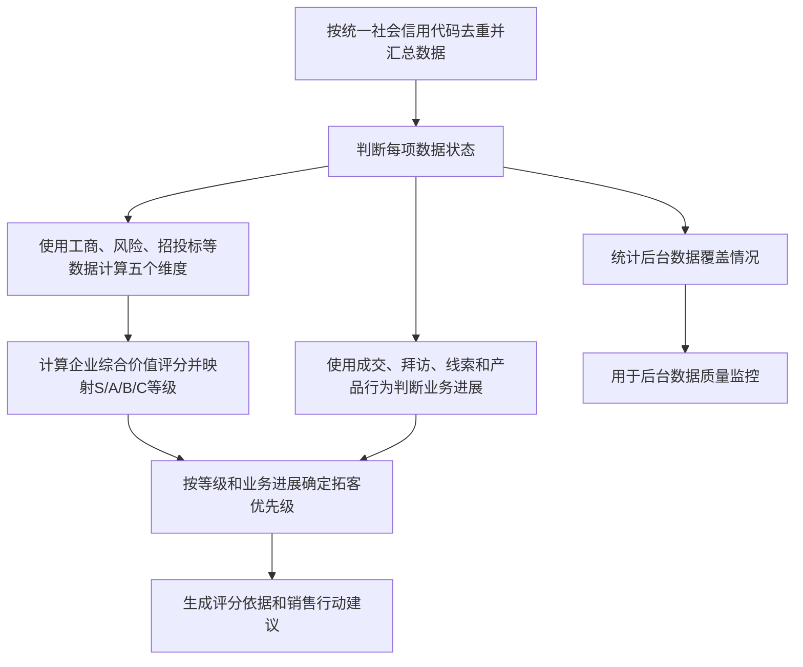

# 客户评分升级 PRD（草稿）

> 当前版本只使用已具备的数据：工商、企业风险、招投标、成交、拜访、线索、产品板块、融资与对外投资。不使用企业所得税、营业收入、净利润、现金流、现金比率、流动比率等财税数据。

| 版本 | 日期 | 变更内容 | 变更人 |
| --- | --- | --- | --- |
| V0.33 | 2026-09-02 | 在评分理由示例中补充独立的业务进展示例 | 刘君 |
| V0.32 | 2026-09-02 | 数据覆盖情况仅用于后台监控，不在客户页面展示 | 刘君 |
| V0.31 | 2026-09-02 | 将数据置信度改为指标覆盖情况，覆盖率仅用于后台监控 | 刘君 |
| V0.30 | 2026-09-02 | 明确产品类型为线索创建必填项，删除无产品类型线索分支 | 刘君 |
| V0.29 | 2026-09-02 | 业务进展新增产品方向明确阶段并排除关闭线索 | 刘君 |
| V0.28 | 2026-09-02 | 将金融产品纳入需求潜力的行业、经营范围和招投标识别 | 刘君 |
| V0.27 | 2026-09-02 | 资金实力由实缴比例改为实缴资本金额评分 | 刘君 |
| V0.26 | 2026-09-02 | 补齐招投标识别规则、统一数据归属、主体异常评分及理由展示 | 刘君 |
| V0.25 | 2026-09-02 | 将维度归一化规则集中到总分公式章节，删除其他章节重复说明 | 刘君 |
| V0.24 | 2026-09-02 | 补全需求潜力计算示例中的有效满分和归一化步骤 | 刘君 |
| V0.23 | 2026-09-02 | 评分理由改为五维分块短句，删除优势、进展、行动和依据等输出标签 | 刘君 |
| V0.22 | 2026-09-02 | 删除企业发展中的扩张类招投标，招投标仅用于需求潜力 | 刘君 |
| V0.21 | 2026-09-02 | 需求潜力缺失字段改为不参与计算，避免无数据得分高于未命中 | 刘君 |
| V0.20 | 2026-09-02 | 精简需求潜力规则，将注册资本改为统一企业规模适配 | 刘君 |
| V0.19 | 2026-09-02 | 全文统一使用“企业综合价值评分” | 刘君 |
| V0.18 | 2026-09-02 | 调整客户评分名称，保留数据置信度和客户等级 | 刘君 |
| V0.17 | 2026-09-02 | 合并风险评分重复规则，改为单表和三步计算说明 | 刘君 |
| V0.16 | 2026-09-02 | 明确一般纳税人、小规模纳税人及否定标签的评分口径 | 刘君 |
| V0.15 | 2026-09-02 | 企业发展新增成立年限指标并重新分配维度内分值 | 刘君 |
| V0.14 | 2026-09-02 | 明确线索仅展示业务推进方向、11类风险系数、企业发展无数据口径及实时重算规则 | 刘君 |
| V0.13 | 2026-09-02 | 修正司法上限、五维指标归属、关闭线索、企业去重及分值精度规则 | 刘君 |
| V0.12 | 2026-09-02 | 取消A/B套，改为企业综合价值评分、业务进展和数据置信度三结果 | 刘君 |
| V0.11 | 2026-09-02 | 明确新老企业及物流、商贸双产品命中时均按单次计分 | 刘君 |
| V0.10 | 2026-09-02 | 统一客户分层名称为高潜、重点、中潜和低潜客户 | 刘君 |
| V0.9 | 2026-09-02 | 参考其他组方案补充风险状态修复、时间衰减及短期集中发生规则 | 刘君 |
| V0.8 | 2026-09-02 | 增加纳税标签、融资历程及瞪羚等企业发展资质数据 | 刘君 |
| V0.7 | 2026-09-02 | 补齐产品板块数据范围，修正A套公式及S级业务含义 | 刘君 |
| V0.6 | 2026-09-02 | 为S/A/B/C客户等级补充中文等级名称 | 刘君 |
| V0.5 | 2026-09-02 | 将产品板块数据纳入可选行为评分，无数据时不参与计算 | 刘君 |
| V0.4 | 2026-09-02 | 区分有/无成交拜访数据两类企业，并将风险分调整为分数越低越健康 | 刘君 |
| V0.3 | 2026-09-02 | 删除财税实算分支，合并重复规则，重写为单一评分口径 | 刘君 |
| V0.2 | 2026-09-02 | 统一缺失数据、中性分、数据源失败、企业发展命名及关闭线索规则 | 刘君 |
| V0.1 | 2026-09-01 | 从客户与线索评分合并草稿中拆分客户评分需求 | 刘君 |

# 第一部分：业务需求

# 01 背景与目标

CRM系统接入企业地图数据后，销售可在地图中查看企业并开展陌生客户拓展。地图中的企业既包含CRM已有客户，也包含尚未创建线索、没有拜访记录或历史成交的新企业。为帮助销售从大量企业中识别优先拓展对象，系统需要基于企业现有的工商、风险、招投标、产品板块、成交和拜访等数据，计算企业综合价值评分和客户等级。

由于大部分待拓展企业只有工商信息，少部分企业才具有招投标、成交、拜访、线索或产品板块数据，客户评分必须在数据覆盖程度不同的情况下均可计算，且不能把“没有成交或拜访数据”直接判断为“客户价值低”。

一句话目标：系统按企业统一输出企业综合价值评分、客户等级和业务进展，支持销售在企业地图中判断拓客优先级，并查看五维判断和销售建议。

# 02 评分流程



## 02.1 企业主体去重与关联

1. 企业地图主体与CRM企业均使用统一社会信用代码作为企业唯一匹配键；仅当双方代码非空且均通过系统现有的18位统一社会信用代码校验时才允许关联。
2. 统一社会信用代码相同的企业地图记录和CRM企业记录合并为同一个评分主体，同一企业只生成一份企业综合价值评分、客户等级和业务进展。
3. CRM中存在多条统一社会信用代码相同的企业记录时，先按统一社会信用代码去重，再汇总未关闭线索、成交、拜访和有效产品行为；订单、拜访及风险事件仍按各自唯一ID去重。
4. 统一社会信用代码为空或格式无效时，不与CRM企业关联，仅使用当前企业地图主体的工商、风险、招投标、融资和对外投资数据继续评分；不得串用CRM中的成交、拜访、线索和产品行为，页面标记“企业主体待核验”。统一社会信用代码不同的企业不得合并。
5. 企业统一社会信用代码发生更正后，重新执行主体关联并生成新评分快照，历史快照保留原关联代码和规则版本。

# 03 企业综合价值评分和业务进展怎么计算

## 03.1 统一规则

1. 同一企业只有一个企业综合价值评分，即客户评分，用于划分S/A/B/C等级。
2. 成交、拜访、线索和产品板块行为等不参与企业综合价值评分，只用于判断业务进展和等级内拓客优先级；没有行为数据不得降低企业综合价值评分。
3. 关闭线索不参与企业综合价值评分和业务进展判断。

## 03.2 总分公式和等级

```text
风险健康贡献 = 100-风险分

企业综合价值评分 = 纳税能力×20% + 风险健康贡献×20% + 需求潜力×30% + 企业发展×15% + 资金实力×15%

维度分 = 该维度有效指标得分合计 ÷ 有效指标满分合计 × 100
```

三者关系：先计算五个维度分，将风险分转换为风险健康贡献，再按权重合并为企业综合价值评分。

维度分公式统一适用于纳税能力、需求潜力、企业发展和资金实力。字段缺失、无法解析或数据源失败的指标不计分，也不计入有效满分；查询成功且明确为0、无记录或未命中时，该指标得0分。风险信息使用第03.5节的风险累计值与中位数算法，不使用维度分公式。

示例：某维度设计满分100分，其中满分40分的指标数据源失败，其余有效指标满分为60分、实际得45分，则该维度分为`45÷60×100=75分`。

计算精度：计算过程保留4位小数；企业综合价值评分四舍五入保留2位小数后划分等级；后台总体覆盖率四舍五入保留2位小数。

| 字母等级 | 中文等级 | 企业综合价值评分 | 含义 |
| --- | --- | ---: | --- |
| S级 | 高潜客户 | ≥80 | 客户综合价值高 |
| A级 | 重点客户 | 60-79.99 | 具备较好基础或明确机会 |
| B级 | 中潜客户 | 40-59.99 | 有开发价值，但证据仍需补充 |
| C级 | 低潜客户 | <40 | 已有证据显示基础、需求或经营状态较弱，或触发重大风险 |

### 计算示例

某企业纳税能力60分、风险分10分、需求潜力70分、企业发展50分、资金实力60分：

```text
风险健康贡献 = 100-10 = 90
企业综合价值评分 = 60×20% + 90×20% + 70×30% + 50×15% + 60×15%
           = 67.50分，对应“A级·重点客户”
```

## 03.3 五个维度总览

| 维度 | 权重 | 当前使用的数据 | 不使用的数据 |
| --- | ---: | --- | --- |
| 纳税能力 | 20% | A级纳税人资质、纳税人类型及状态、工商经营状态、参保人数 | 注册资本、实缴资本金额、所得税、增值税、营业税 |
| 风险信息 | 20% | 工商、司法和舆情风险；风险分越低越健康 | 财务风险指标、成交及产品活跃行为 |
| 需求潜力 | 30% | 工商行业、经营范围、注册资本、招投标需求 | 成交、拜访、线索和产品类型 |
| 企业发展 | 15% | 成立年限，瞪羚、独角兽、专精特新、高新技术等企业资质，工商扩张、战略布局舆情 | 营收、净利润及其增长率 |
| 资金实力 | 15% | 实缴资本金额、融资历程、对外投资 | 企业规模适配、现金流、现金比率、流动比率 |

## 03.4 纳税能力（0-100分）

> 当前没有完整税额数据。本维度根据A级纳税人资质、纳税人类型及经营稳定代理指标估算“纳税能力”，页面必须展示“资质与经营稳定估算”，不得展示为实际纳税额。

| 指标 | 满分 | 评分规则 |
| --- | ---: | --- |
| 纳税资质 | 40 | `ods_wlyd_kq_taxpayer_a_df`存在有效A级纳税人记录，或`taxpayer_a_num>0`得40；查询成功但无A级纳税人资质得10；字段缺失、无法解析或数据源失败时不参与计算 |
| 纳税人类型及状态 | 30 | 明确为“是一般纳税人”且状态正常得30；明确为“是小规模纳税人”且状态正常得20；仅有“非一般纳税人”或“非小规模纳税人”标签时不反向推断类型，按类型未确认得15；查询成功但无类型记录得0；非正常户、重大税收违法或存在当前欠税得0；字段缺失、无法解析或数据源失败时不参与计算 |
| 工商经营状态 | 15 | 存续、在业或正常经营得15；迁出或停业得5；注销、吊销或清算得0并按风险一票否决处理；字段为空或无法识别时不参与计算，异常状态写入后台数据覆盖监控 |
| 参保人数 | 15 | ≥100人得15；20-99人得11；1-19人得6；确认0人得0；字段缺失或无法解析时不参与计算 |

纳税资质的数据优先级为：A级纳税人表有效记录 > 企业基本信息表中的纳税A级数量。纳税资质与纳税人类型及状态分别计分，不在同一指标内重复取值。

纳税人类型读取`taxpayer_qualification`字段。“非一般纳税人”和“非小规模纳税人”仅用于排除对应类型，不得据此推断企业属于另一类型；若“是一般纳税人”和“是小规模纳税人”同时出现，按数据冲突处理，该指标不参与计算，冲突状态写入后台数据覆盖监控。

## 03.5 风险信息（0-100分）

风险分越低，企业越健康；查询成功且未发现任何风险时，风险分为0。本方案仅采用参考方案的状态和时间衰减机制，不采用其风险等级、注册资本分池及原始分值。

| 风险 | 基础值/单类上限 | 怎么计入 | 字段异常处理 |
| --- | --- | --- | --- |
| 被执行人 | 每条6/最高18 | 企业为被执行主体；未终结按100%计入，已履行或已终结≤180天按20%计入，超过180天不计入 | 状态缺失时该条不计算 |
| 失信被执行人 | 一票否决 | 当前有效：风险分100、企业综合价值评分0、C级·低潜客户；已撤销或移出不计入 | 状态缺失时该条不计算 |
| 经营异常 | 每条4/最高4 | 当前在名录按100%计入；移出≤180天按20%计入，超过180天不计入 | 状态缺失时该条不计算 |
| 行政处罚 | 每条2/最高6 | 近24个月计入：0-180天按100%，181-365天按60%，366-730天按30% | 日期缺失时该条不计算 |
| 股权出质 | 每条1/最高3 | 当前有效按100%计入；注销≤180天按20%计入，超过180天不计入 | 状态缺失时该条不计算 |
| 司法案件 | 每条2/最高6 | 近24个月内，企业为被告、被申请人或被执行主体时计入：0-180天按100%，181-365天按60%，366-730天按30% | 日期缺失时该条不计算 |
| 限制高消费 | 每条8/最高16 | 当前有效按100%计入；解除≤180天按20%计入，超过180天不计入 | 状态缺失时该条不计算 |
| 法人变更 | 每家企业2/最高2 | 近12个月计一次：0-180天按100%，181-365天按60% | 日期缺失时不计算 |
| 注销、吊销或清算 | 一票否决 | 当前命中：风险分100、企业综合价值评分0、C级·低潜客户；恢复正常经营后不计入 | 工商状态缺失时该类不计算 |
| 重大诉讼或仲裁 | 每个事件6/最高12 | 近24个月计入：0-180天按100%，181-365天按60%，366-730天按30% | 日期缺失时该条不计算 |
| 高管变动或负面新闻 | 每个事件2/最高4 | 近12个月计入：0-180天按100%，181-365天按60% | 日期缺失时该条不计算 |

补充规则：

- 事件型风险的状态系数固定为1，只按发生时间衰减；存续状态型风险的时间系数固定为1，只按当前状态及解除时间衰减。
- 同一案号、处罚决定书号或事件ID只计一次。立案、开庭和公告属于同一案号时，合并为一条司法案件；企业作为原告主动维权时不计风险。
- 缺失或无法解析的状态、日期不参与计算，异常状态写入后台数据覆盖监控，不在客户页面展示。一票否决规则不参与折算。

```text
单条风险值 = 每条风险权重×状态系数×时间系数
单类风险累计值 = MIN(该类全部单条风险值之和, 单类最高计入值)
企业风险累计值I = 各类风险累计值之和
风险累计值中位数M = 近180天完成评分且数据覆盖口径相同的有风险企业累计值中位数
风险分R = MIN(100, ROUND_HALF_UP(30×I÷M, 0))
```

计算顺序：

1. 每条风险按“基础值×状态系数×时间系数”折算。
2. 同类风险相加，但不超过单类上限；再将各类结果相加得到企业风险累计值。
3. 企业累计值与近180天同口径企业的中位数比较后换算为0-100分。等于中位数时为30分；未发现风险为0分，最高为100分。

计算示例：某企业有1条当前未终结的被执行人记录，单条风险值为`6×1=6`；另有1条100天前发生的行政处罚，单条风险值为`2×1×1=2`；还有1条已于60天前移出的经营异常，单条风险值为`4×0.2=0.8`。企业风险累计值为`6+2+0.8=8.8`，再与同口径企业的风险累计值中位数比较后换算风险分。

- 部分风险数据源失败时，失败类型同时从当前企业风险累计值I和样本中位数M中排除，只与风险数据覆盖范围相同的企业比较。
- 没有可用中位数时，沿用上一周期同口径中位数；仍没有历史值时，风险分使用50分并进入人工核验。

## 03.6 需求潜力（0-100分）

### 企业产品匹配规则

1. 所有企业均根据工商行业和经营范围判断产品匹配，不受是否已有线索影响。
2. 命中物流、货运、仓储、物流服务或供应链物流时，匹配物流产品；命中批发零售、制造、金属、矿、消费品、大宗商品或期货时，匹配商贸产品；命中银行、保险、证券、信托、保理、融资租赁或金融服务时，匹配金融产品。
3. 同一指标只计一次；同时匹配物流、商贸或金融中的多个产品方向时，保留全部方向，但不重复得分。线索产品类型只展示业务推进方向，不参与需求潜力评分；关闭线索及其附属数据全部排除。

例如：企业行业属于物流，经营范围同时包含金属贸易和供应链金融，系统展示物流、商贸和金融三个产品方向，但行业、经营范围各只计一次。

所有企业统一使用以下规则，不再根据有无成交、拜访或产品板块数据切换评分方案。四项指标满分合计100分。

| 指标 | 满分 | 明确评分规则 |
| --- | ---: | --- |
| 工商行业产品匹配 | 27 | 命中物流、货运、仓储、物流服务、供应链物流得27并匹配物流产品；命中批发零售、商贸流通、制造业得27并匹配商贸产品；命中银行、保险、证券、信托、保理、融资租赁、金融服务得27并匹配金融产品；其他行业得5；字段缺失或无法解析时不参与计算 |
| 经营范围产品匹配 | 18 | 命中运输、货运、仓储、配送、物流、供应链得18并匹配物流产品；命中金属、矿、消费品、大宗商品、期货得18并匹配商贸产品；命中供应链金融、保理、融资、授信、贷款、票据、支付结算得18并匹配金融产品；均未命中得0；字段缺失或无法解析时不参与计算 |
| 企业规模适配 | 9 | 注册资本＜100万元得4分；100万-500万元得9分；＞500万-1000万元得7分；＞1000万-5000万元得5分；＞5000万元得3分；字段缺失或无法解析时不参与计算。该规则面向公司全部产品，不按产品类型分别计算 |
| 招投标需求 | 46 | 近180天命中公司物流、商贸或金融产品得46；命中ERP或一般数字化需求得27；仅弱相关得9；查询成功且无相关项目得0；数据源失败时不参与计算 |

招投标识别规则：

1. 依次匹配`title`（标题）、`project_name`（项目名称）、`business`（采购品目）和`text`（公告正文）；`text`为空时使用`content_md`。任一字段命中即可。
2. 物流产品词包括物流、运输、货运、仓储、配送、TMS、WMS、供应链；商贸产品词包括金属、矿产、消费品、大宗商品、期货、交易平台；金融产品词包括供应链金融、保理、融资、授信、贷款、票据、支付结算。
3. 同一项目命中多个产品或多个分值档位时只计一次，取最高分。企业作为招标方或中标方均可使用，同一企业同一项目按项目ID去重。

成交、拜访、线索和产品行为不改变需求潜力分。

## 03.7 业务进展

业务进展不参与企业综合价值评分，只用于说明销售与企业当前的关系阶段，并在同一客户等级内确定拓客优先级。系统按以下顺序取企业命中的最高阶段：

| 优先顺序 | 业务进展 | 明确判定规则 |
| ---: | --- | --- |
| 1 | 已成交 | 企业存在已完成的有效订单，或存在状态为成交的线索；订单按订单ID去重 |
| 2 | 商务推进 | 近90天有效拜访记录中明确出现提交方案、报价、合同沟通、商务谈判或采购审批，且尚未成交 |
| 3 | 需求明确 | 近90天有效拜访记录中明确提出采购、询价、产品需求、实施范围或计划时间，且未进入商务推进 |
| 4 | 产品方向明确 | 企业存在未关闭线索；产品类型为线索创建必填项，但尚未命中更高阶段 |
| 5 | 初步接触 | 企业存在有效拜访记录，或存在产品注册及产品活跃行为，但没有未关闭线索且未命中更高阶段 |
| 6 | 尚未接触 | 成交、拜访、未关闭线索和产品行为数据源均查询成功且均无记录 |

业务进展的数据处理规则：

1. 成交、拜访、线索和产品板块数据只提供进展证据，不对企业综合价值评分加分或扣分。
2. 产品类型为线索创建必填项；只要企业存在未关闭线索，即可根据该线索的产品类型判定“产品方向明确”。关闭线索及其附属的产品类型、产品板块和历史产品行为完全排除。
3. 企业可能存在多条有效线索，应按线索分别处理，不得合并；不同产品类型的有效线索全部保留。多条线索、多次拜访命中不同阶段时，各线索分别取其命中的最高阶段，并保留支撑对应阶段的最新有效依据。
4. 任一行为数据源失败但其他来源存在明确进展证据时，按现有最高证据展示，并标记“部分进展数据待补充”。
5. 四类行为数据源全部失败时，不得展示“尚未接触”，改为展示系统状态“进展数据待补充”。
6. 拜访内容由AI提取阶段证据，规则引擎根据结构化结果确定业务进展；AI不得自行改变阶段优先级。

同一S/A/B/C等级内，企业地图默认先按业务进展排序：已成交＞商务推进＞需求明确＞产品方向明确＞初步接触＞尚未接触；业务进展相同时，再按企业综合价值评分从高到低排序。“进展数据待补充”的企业排在同等级末尾。

## 03.8 后台数据覆盖监控

数据覆盖情况仅用于后台监控，不在企业地图、客户评分卡、评分明细或销售理由中展示，也不改变企业综合价值评分、客户等级和业务进展。

26项指标包括：纳税能力4项、风险信息11项、需求潜力4项、企业发展4项、资金实力3项。

```text
待补充指标数 = 26-已覆盖指标数
后台记录 = 已覆盖{已覆盖指标数}/26项，{待补充指标数}项待补充
```

- 查询成功且字段有效时计为已覆盖；查询成功且明确为0、无记录或未命中，也计为已覆盖。
- 字段缺失、无法解析或数据源失败时计为待补充，不得把该指标显示为0分数据。
- 风险信息按11类风险分别统计；某类风险查询成功且无记录时，该类计为已覆盖。
- 成交、拜访、线索和产品行为不属于五维评分指标，不计入26项。

例如：系统成功取得20项指标，其中6项缺失或查询失败，后台记录“已覆盖20/26项，6项待补充”及具体待补充指标名称。

后台同时计算以下覆盖率：

```text
单维度覆盖率 = 该维度有效指标满分合计 ÷ 该维度设计满分合计

总体覆盖率 = 纳税能力覆盖率×20%
           + 风险信息覆盖率×20%
           + 需求潜力覆盖率×30%
           + 企业发展覆盖率×15%
           + 资金实力覆盖率×15%
```

风险信息覆盖率按本文11类风险中查询成功的风险类型数量计算；其他维度按有效指标满分计算。查询成功且无记录属于已覆盖，数据源未接入、查询失败或解析失败属于未覆盖。整个维度失败并使用50分时，该维度覆盖率为0。后台可按企业、维度和数据源统计覆盖率，用于发现数据接入和数据质量问题。

## 03.9 企业发展（0-100分）

| 指标 | 满分 | 评分规则 |
| --- | ---: | --- |
| 企业发展资质 | 45 | 独角兽企业得45；瞪羚企业或专精特新小巨人得40；专精特新、高新技术企业或技术创新示范企业得35；科技型中小企业得25；均未命中得0；同时命中多个资质时只取最高档 |
| 工商扩张 | 30 | 近12个月新增分公司、注册资本增加：命中2项得30，1项得15；查询成功且均未发生得0；字段缺失、查询失败或解析失败时不参与计算 |
| 战略布局舆情 | 20 | 明确扩产、出海、并购或新业务布局得20；一般合作或规划得10；查询成功且无相关信息得0；数据源失败时不参与计算。融资信息不在本指标使用 |
| 成立年限 | 5 | 按评分日期与工商成立日期计算完整经营年限：≤1年得1分；＞1年且≤3年得2分；＞3年且≤5年得3分；＞5年且≤10年得4分；＞10年得5分；成立日期缺失或无法解析时不参与计算 |

企业发展资质直接读取`ods_wlyd_kq_company_info_df`中的布尔字段：`unicorn`、`gazelles`、`zhuanjing_xiaojuren`、`zhuanjing`、`high_tech_company`、`technology_innovation`、`small_medium_tech_company`。例如`gazelles=true`时，企业发展资质得40分，并在理由中展示“企业已被认定为瞪羚企业，具备较强成长性”。成立年限使用同表工商成立日期计算。

页面展示企业不足时使用“企业发展短板”，不得使用“企业发展缺陷分”。

## 03.10 资金实力（0-100分）

> 当前没有现金流等财务数据。本维度为工商与融资估算，页面必须展示“工商融资估算”。

| 指标 | 满分 | 评分规则 |
| --- | ---: | --- |
| 实缴资本金额 | 35 | 金额统一换算为人民币万元：0万元得0分；＞0且≤100万元得9分；＞100且≤500万元得18分；＞500且≤1000万元得25分；＞1000万元得35分；字段缺失、无法解析或数据源失败时不参与计算 |
| 融资历程 | 40 | `ods_wlyd_kq_financing_process_df`近3年有效融资记录≥2条得40，1条得32；只有3年前融资记录得12；查询成功且无融资记录得0；数据源失败时不参与计算
 |
| 对外投资 | 25 | 有效投资企业≥5家得25；2-4家得15；1家得8；查询成功且无对外投资得0；数据源失败时不参与计算 |

企业规模适配不参与资金实力，只在需求潜力维度反映企业整体规模与公司产品的适配程度。

# 04 评分理由和页面展示

## 04.1 面向销售的理由

系统必须按照纳税能力、风险信息、需求潜力、企业发展、资金实力五个维度分别生成理由。每个维度以标题分块，输出2—3条短句，总共字数不超过300个字，不展示分值、加分、扣分、权重、命中档位或内部依据ID。

```text
【维度名称】
- 基于真实数据说明企业现状。
- 有已发生的业务事实时直接说明；没有时省略本条。
- 给出一项明确、可执行的销售建议。
```

| 维度 | 输出示例 |
| --- | --- |
| 纳税能力 | 企业具有A级纳税人记录，当前纳税人状态正常。建议通过拜访确认实际经营规模和当前业务量。 |
| 风险信息 | 当前未发现失信、注销、吊销等重大风险。建议在签约前再次核验司法风险和付款保障条件。 |
| 需求潜力 | 企业行业及经营范围与公司物流产品匹配，近期招投标项目出现仓储需求。建议确认项目范围、预算和计划时间。 |
| 企业发展 | 企业已被认定为瞪羚企业，近期新增分公司。建议核实新增业务布局及其物流、商贸配套需求。 |
| 资金实力 | 企业实缴、融资或对外投资信息显示具备一定项目投入基础。建议确认项目预算、付款方式和回款周期。 |
| 业务进展（不参与评分） | 企业已创建物流产品线索，近90天已完成拜访并提出仓储需求，目前处于需求明确阶段。建议继续确认实施范围和计划时间。 |

上述内容仅为格式示例。业务进展必须独立展示，不得写入五个维度的评分理由。系统只能使用当前企业实际存在的事实；某类事实不存在时直接省略，不输出空标签，也不得编造“以前成交过”“有采购意向”等内容。

## 04.2 五维评分理由提示词框架

```text
【角色】
你是CRM客户评分解释助手。你的任务是把已经计算完成的客户评分依据，转化为销售可以理解和执行的客户判断。你不负责重新计算分数。

【输入】
1. 企业基本信息：{企业名称、统一社会信用代码、行业、经营范围、工商经营状态、参保人数、纳税人类型、纳税人状态、企业发展资质}
2. 风险信息：{风险类型、记录数、状态、发生时间、原文依据}
3. 需求潜力信息：{工商行业产品匹配、经营范围产品匹配、企业规模适配、招投标需求；同时提供数据状态}
4. 企业发展信息：{成立日期、成立年限、瞪羚、独角兽、专精特新、高新技术等企业资质、工商扩张、战略布局舆情}
5. 资金实力信息：{实缴资本金额、融资历程、对外投资}
6. 评分结果：{企业综合价值评分对应等级、业务进展、五个维度的命中依据、未参与计算的指标}
7. 业务进展依据：{成交、拜访、未关闭线索及其产品类型、产品注册与产品行为，以及数据状态}

【任务】
按照以下五个维度依次生成评分理由，不得遗漏：
1. 纳税能力
2. 风险信息
3. 需求潜力
4. 企业发展
5. 资金实力

每个维度输出2—3条短句，只解释该维度实际参与评分的数据；最后一条给出明确、可执行的销售建议。成交、拜访、线索和产品行为不得写入五维评分理由，统一写入单独的“业务进展”区域。

【强制规则】
1. 不展示企业综合价值评分、维度分、指标分、权重、加分、扣分或命中档位。
2. 不使用“获得X分”“加X分”“扣X分”“因此评为X级”等评分话术。
3. 不得把无成交、无拜访或数据源失败描述为客户缺点或有利条件。
4. 不得编造历史成交、采购意向、预算、决策人、经营规模或风险事实。
5. 风险分越低代表企业越健康，但输出理由时只描述具体风险事实和业务影响，不展示风险分。
6. 每条结论必须能够关联到输入中的来源字段或原文依据。
7. 成交、拜访、线索和产品行为只用于解释业务进展，不得用于解释企业综合价值评分高低。

【输出格式】
【{纳税能力/风险信息/需求潜力/企业发展/资金实力}】
- {企业现状}
- {该维度实际参与评分的事实；没有则省略}
- {销售建议}

【业务进展】
- {直接说明已完成的拜访、成交、未关闭线索及其产品方向或产品行为；均无记录时展示“尚未接触”}

禁止在输出中出现“客户优势”“已有进展”“下一步行动”“依据”等字段名。来源字段和原文依据ID仅供系统追溯，不面向销售输出。
```

## 04.3 页面展示

| 组件 | 展示内容 |
| --- | --- |
| 客户评分卡 | 企业综合价值评分、字母等级、中文等级、业务进展和更新时间；统一展示为“S级·高潜客户”等组合名称 |
| 五维雷达图 | 纳税能力、风险健康贡献、需求潜力、企业发展、资金实力；风险明细另行展示0-100风险分，并注明“越低越健康” |
| 评分明细 | 原始字段、命中档位、指标分、维度分和公式；不展示后台数据覆盖情况 |
| 销售建议 | 按五个维度分块展示2—3条短句，只解释实际参与评分的数据，不展示分类标签和加减分话术 |
| 业务进展 | 单独展示已完成的拜访、成交、未关闭线索及其产品方向和产品行为，不与五维评分理由混合 |
| 关联线索 | 进行中、成交、关闭线索摘要；关闭线索及其附属产品类型、产品板块和历史产品行为全部排除，不参与企业综合价值评分和业务进展 |
| 地图排序 | 先按S/A/B/C等级，再按业务进展优先级，最后按企业综合价值评分从高到低排序 |

# 第二部分：AI与系统方案

# 06 系统职责

| 模块 | 职责 |
| --- | --- |
| 客户评分编排 | 按统一社会信用代码关联企业地图与CRM企业、去重并汇总数据，识别有记录、无记录、数据源失败三种状态 |
| 规则计算 | 按本文第03章确定性计算指标分、维度分、企业综合价值评分、等级和业务进展，并统计已覆盖、待补充指标及后台覆盖率 |
| AI依据提取 | 从拜访、招投标和舆情原文提取需求、发展和风险事实 |
| 理由生成 | 将真实依据转化为按五个维度分块的简短判断和销售建议 |
| 评分快照 | 保存数据时间、来源、命中规则、分值、覆盖状态和版本 |

AI不得修改评分公式、权重、档位、中位数、等级或业务进展优先级，只能提取事实和生成解释。

# 07 数据来源

| 数据 | 用途 |
| --- | --- |
| 企业基本信息表 `ods_wlyd_kq_company_info_df` | 统一社会信用代码、成立日期、行业、经营范围、注册资本、实缴资本、参保人数、纳税人类型和状态、A级纳税人数量、企业发展资质、工商扩张及经营状态。核心字段包括企业唯一标识、成立日期字段、`industry`、`business_scope`、`regit_capital`、`contributed_capital`、`social_security_num`、`taxpayer_qualification`、`taxpayer_state_search`、`taxpayer_a_num`、`gazelles`、`unicorn`、`zhuanjing`、`zhuanjing_xiaojuren`等 |
| 纳税A级表 `ods_wlyd_kq_taxpayer_a_df` | 通过企业唯一标识查询A级纳税人有效记录，用于纳税资质指标判断 |
| 企业风险 | 被执行、失信、经营异常、处罚、司法、限高等风险 |
| 招投标 | 使用标题、项目名称、采购品目和公告正文识别物流、商贸、金融等公司产品需求；招标方和中标方数据均可使用，仅用于需求潜力 |
| 成交/订单 | 判断业务进展中的“已成交”；不提高或降低企业综合价值评分 |
| 拜访 | 判断初步接触、需求明确或商务推进；不提高或降低企业综合价值评分 |
| 产品板块数据 | 只读取进行中或成交线索中已选择的产品类型、产品板块，以及对应的产品注册、活跃度、GTV客户类型和交易活跃标签；用于判断业务进展，不参与企业综合价值评分；关闭线索附属数据完全排除 |
| 关联线索 | 展示产品类型、状态和结果；成交线索可判定已成交，未关闭线索判定产品方向明确；关闭线索及其附属字段完全排除 |
| 舆情 | 重大诉讼、负面新闻和战略布局 |
| 融资历程表 `ods_wlyd_kq_financing_process_df` | 通过企业唯一标识查询融资记录和融资时间，用于资金实力评分 |
| 对外投资数据 | 有效对外投资企业数量，用于资金实力评分；数据源沿用当前已接入的企业对外投资数据 |

# 第三部分：人机协作与产出物管理

# 11 人工处理

| 场景 | 处理规则 |
| --- | --- |
| CRM查询企业评分 | CRM每次调用评分接口时，系统实时查询当前数据并重新计算企业综合价值评分、等级和业务进展；同时更新后台数据覆盖监控，不沿用上一次计算结果。来源数据发生变化后，下一次接口调用必须返回按最新数据计算的结果 |
| 用户刷新评分 | 触发CRM重新调用评分接口并实时计算，不修改原始业务数据 |
| 用户发现依据错误 | 标记待审核，修正来源数据后重新计算 |
| 人工调分 | 不覆盖系统企业综合价值评分；另存人工分、原因、操作人和有效期 |

# 12 产出物

每次CRM调用评分接口均保存一份客户评分快照，包括统一社会信用代码、CRM企业ID、企业综合价值评分、等级、业务进展、已覆盖指标数、待补充指标数、后台覆盖率、五维明细、数据状态、关联线索范围、事实依据、规则版本和评分时间。评分快照仅用于追溯，不作为下一次接口调用的计算结果；下一次调用必须基于当次查询到的最新数据重新计算。

# 第四部分：异常处理与效果度量

# 13 异常处理

| 场景 | 系统处理 |
| --- | --- |
| 成交、拜访、未关闭线索和产品行为均查询成功且无记录 | 企业综合价值评分不变，业务进展展示“尚未接触” |
| 成交、拜访、线索或产品行为存在记录 | 企业综合价值评分不变，按最高有效证据判断业务进展 |
| 四类业务进展数据源全部失败 | 企业综合价值评分不变，业务进展展示“进展数据待补充” |
| 数据源查询失败 | 对应指标不参与计算，失败状态仅写入后台数据覆盖监控 |
| 整个维度均失败 | 该维度使用50分，覆盖状态仅写入后台数据覆盖监控 |
| 统一社会信用代码为空或格式无效 | 仅使用当前企业地图主体数据继续评分，不关联CRM数据；标记“企业主体待核验” |
| 命中一票否决 | 企业综合价值评分为0、C级·低潜客户，并展示具体风险依据 |

# 14 验收标准与测试用例

| 编号 | 场景 | 预期结果 |
| --- | --- | --- |
| T-01 | 企业没有成交、拜访、线索和产品行为，且四类数据源均查询成功 | 企业综合价值评分正常计算，业务进展为“尚未接触”，行为缺失不降低企业综合价值评分 |
| T-02 | 企业潜力数据完全相同，其中一家存在历史成交 | 两家企业综合价值评分和客户等级相同；有成交企业业务进展为“已成交”并在同等级内优先排序 |
| T-03 | 企业只有一条未关闭线索，无拜访、成交和产品行为 | 线索创建时已选择产品类型，业务进展为“产品方向明确”；企业综合价值评分不变 |
| T-04 | 近90天拜访明确提出采购需求，但尚未报价 | 业务进展为“需求明确”，企业综合价值评分不变 |
| T-05 | 近90天拜访记录显示已提交报价或合同沟通 | 业务进展为“商务推进”，企业综合价值评分不变 |
| T-06 | 企业存在有效订单或成交线索 | 业务进展为“已成交”；订单按订单ID去重 |
| T-07 | 企业同时命中成交和商务推进 | 按最高阶段展示“已成交”，同时保留最新有效依据 |
| T-08 | 企业只有一条关闭物流线索，线索内有产品板块和历史产品行为 | 关闭线索及其附属数据全部排除，不改变企业综合价值评分和业务进展 |
| T-09 | 企业存在物流和商贸两条有效线索 | 两个产品类型全部保留，页面展示“多个业务推进方向”；线索产品类型不进入需求潜力评分 |
| T-10 | 四类业务进展数据源全部失败 | 不展示“尚未接触”，展示“进展数据待补充”；企业综合价值评分不变 |
| T-11 | 部分业务进展数据源失败，但已有明确成交证据 | 业务进展为“已成交”，同时标记“部分进展数据待补充” |
| T-12 | 企业注册资本为300万元 | 企业规模适配得9分，不影响纳税能力和资金实力 |
| T-13 | 制造、批零、金属、矿或大宗商品企业 | 命中商贸产品，并展示命中字段和关键词 |
| T-14 | 新企业行业为物流，经营范围同时包含金属贸易 | 同时展示物流和商贸产品方向；行业和经营范围指标各只计一次，企业规模适配按统一规则计算 |
| T-15 | 已有线索企业行业为物流，经营范围同时包含金属贸易 | 产品匹配结果与新企业一致；线索产品类型只用于业务进展，不造成产品匹配重复计分 |
| T-16 | 招投标数据源失败 | 招投标不赋0分，需求潜力按第03.2节统一维度分公式计算 |
| T-17 | 风险数据查询成功且无风险 | 风险分为0，风险健康贡献为100 |
| T-18 | 命中失信、注销、吊销或清算 | 风险分为100，企业综合价值评分为0，等级展示为“C级·低潜客户” |
| T-19 | 某潜力维度全部数据源失败 | 该维度使用50分、后台维度覆盖率为0；客户页面不展示覆盖提示 |
| T-20 | 26项评分指标均查询成功，其中部分指标明确为0或无记录 | 后台记录“已覆盖26/26项，0项待补充”；明确为0或无记录仍计为已覆盖，客户页面不展示覆盖情况 |
| T-21 | 20项指标查询成功，6项字段缺失或数据源失败 | 后台记录“已覆盖20/26项，6项待补充”及6项具体名称，客户页面不展示覆盖情况 |
| T-22 | 企业综合价值评分82分且有6项待补充 | 客户页面仅展示原企业综合价值评分和客户等级；待补充指标不得降低评分或等级 |
| T-23 | 后台计算总体覆盖率 | 保存加权覆盖率用于数据质量监控，企业地图、客户评分卡、评分明细和销售理由均不展示 |
| T-24 | A级纳税人表存在企业有效记录 | 纳税资质得40分，并展示A级纳税人依据；纳税人类型及状态单独按其指标计算 |
| T-25 | 企业基本信息表中`gazelles=true` | 企业发展资质得40分，并展示“瞪羚企业”成长优势 |
| T-26 | 近3年存在2条有效融资历程 | 融资历程得32分，并展示融资记录及时间依据 |
| T-27 | 纳税A级表或融资历程表查询失败 | 对应指标不赋0分，按第03.2节统一维度分公式计算，并降低对应维度覆盖率 |
| T-28 | 企业作为原告参与司法案件 | 不计入风险分，只可在企业司法信息中展示 |
| T-29 | 被执行记录已履行且距状态变更60天 | 该记录按状态系数0.2折算，不再按当前未终结风险计算 |
| T-30 | 行政处罚距今300天且仍在24个月统计窗口内 | 该记录按时间系数0.6折算 |
| T-31 | 企业作为被告存在5条有效司法案件 | 每条按权重计算后封顶，司法案件单类累计值为6，不再乘1.2 |
| T-32 | 生成销售理由 | 按五个维度分别输出2—3条短句，只解释实际参与评分的数据；拜访、成交、线索和产品行为单独展示在“业务进展”区域 |
| T-33 | 某维度没有可引用的业务事实 | 省略对应短句，只展示有事实支撑的判断和销售建议，不输出空标签或编造事实 |
| T-34 | 企业地图企业与CRM企业统一社会信用代码相同 | 合并为同一个评分主体，只生成一份企业综合价值评分、等级和业务进展 |
| T-35 | CRM存在两条统一社会信用代码相同的企业记录 | 先按统一社会信用代码去重，再汇总未关闭线索及有效业务数据 |
| T-36 | 企业名称相同但统一社会信用代码不同 | 不得合并为同一企业，不得串用成交、拜访、线索和产品行为 |
| T-37 | 统一社会信用代码为空或格式无效 | 不关联CRM数据，仅使用当前企业地图主体数据继续评分，页面展示“企业主体待核验” |
| T-38 | 企业综合价值评分中间值为79.9954 | 四舍五入保留2位后为80.00，再划分为“S级·高潜客户” |
| T-39 | 企业综合价值评分中间值为79.9949 | 四舍五入保留2位后为79.99，再划分为“A级·重点客户” |
| T-40 | 工商扩张查询成功且近12个月未新增分公司、未增加注册资本 | 工商扩张得0分，表示确认未发生扩张 |
| T-41 | 工商扩张字段缺失、查询失败或解析失败 | 工商扩张不参与计算，异常状态仅写入后台数据覆盖监控 |
| T-42 | 行政处罚记录没有状态字段，但事件日期有效 | 按事件型风险处理，状态系数默认取1，时间系数按事件日期计算 |
| T-43 | 法人变更发生于300天前 | 状态系数取1，时间系数取0.6 |
| T-44 | 来源数据发生变化后CRM再次调用评分接口 | 系统基于当次最新数据实时重新计算并返回结果，不复用上一评分快照 |
| T-45 | 企业成立日期距评分日期不足或等于1个完整年度 | 成立年限得1分 |
| T-46 | 企业成立日期距评分日期超过10个完整年度 | 成立年限得5分 |
| T-47 | 企业成立日期缺失或无法解析 | 成立年限指标不参与计算，企业发展按第03.2节统一维度分公式计算 |
| T-48 | `taxpayer_qualification`为“是一般纳税人”且状态正常 | 纳税人类型及状态得30分 |
| T-49 | `taxpayer_qualification`为“是小规模纳税人”且状态正常 | 纳税人类型及状态得20分 |
| T-50 | 仅存在“非一般纳税人”或“非小规模纳税人”标签 | 不反向推断类型，按类型未确认得15分 |
| T-51 | “是一般纳税人”和“是小规模纳税人”同时出现 | 该指标不参与计算，冲突状态仅写入后台数据覆盖监控 |
| T-52 | 工商行业、经营范围或注册资本字段缺失 | 对应指标不参与计算，需求潜力按第03.2节统一维度分公式计算 |
| T-53 | 经营范围字段存在但未命中任何产品关键词 | 经营范围产品匹配得0分，不按字段缺失处理 |
| T-54 | 同一招投标项目同时命中物流、金融和一般数字化关键词 | 同一项目只计一次，招投标需求取最高档46分 |
| T-55 | 企业在项目中仅为中标方 | 该项目可参与招投标需求识别，并按项目ID去重 |
| T-56 | 企业存在对外投资和融资记录 | 对外投资、融资只在资金实力计分，不再影响工商扩张和战略布局舆情 |
| T-57 | 已完成拜访但五维评分数据不变 | 五维理由不引用拜访；“业务进展”区域展示已完成拜访及对应阶段 |
| T-58 | 实缴资本金额为500万元 | 实缴资本金额得18分 |
| T-59 | 实缴资本金额字段缺失或无法解析 | 该指标不参与计算，资金实力按第03.2节统一维度分公式计算 |
| T-60 | 企业行业为融资租赁或金融服务 | 工商行业产品匹配得27分并展示金融产品方向 |
| T-61 | 企业经营范围包含保理、授信、贷款、票据或支付结算 | 经营范围产品匹配得18分并展示金融产品方向；同时命中其他产品方向时仍只计一次 |
| T-62 | 企业只有一条已关闭线索且线索已选择产品类型 | 关闭线索及其产品类型完全排除，不得判定为“产品方向明确”或“初步接触” |
